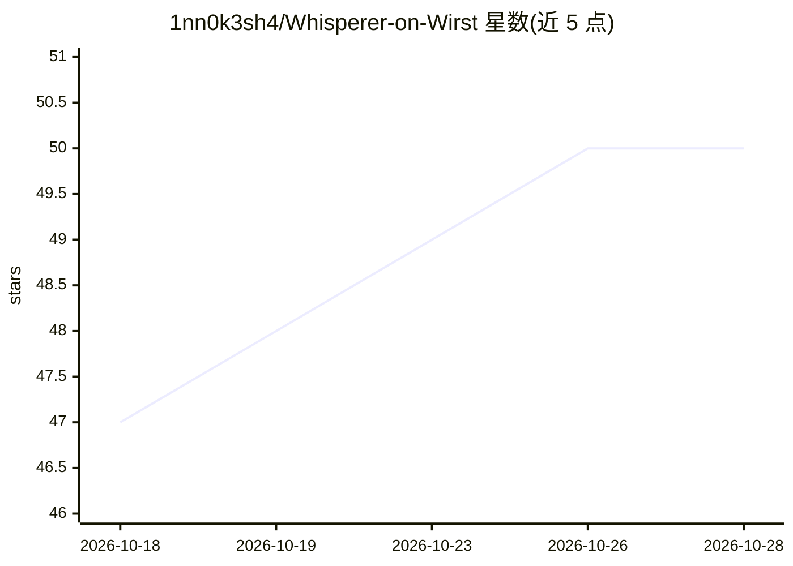

# 1nn0k3sh4/Whisperer-on-Wirst

⭐ 50 · C++ · MIT · 推送 2026-01-14 · [GitHub](https://github.com/1nn0k3sh4/Whisperer-on-Wirst) · 个人维护

**戴在手腕上的本地 AI 伴侣：M5 设备经 WiFi 连本地 LLM**

面向 M5StickC Plus2 与 M5 Core 可穿戴硬件的开源 AI 伴侣项目。设备固件以 PlatformIO 编译烧录，通过 WiFi 连接同局域网计算机上运行的 Ollama，实现不依赖云端的文本交互；配备传感器响应的眼睛动画作为情感表达层。语音输入仍在开发中，插件系统等属规划阶段。安装流程包括克隆仓库、PlatformIO 选环境上传固件、在计算机上安装 Ollama 并拉取模型、配置 WiFi 凭据。

## 筛选速览

| 维度 | 判定 | 备注 |
|---|---|---|
| AI 角色 | `ai-native` | 本体是模型或模型工具 |
| 许可风险 | `permissive` | MIT |
| 部署形态 | `None` |  |
| 模型依赖 | local-ok | 支持本地模型 |
| 硬件要求 | — | 无带数字的原话,不猜 |
| 安装摩擦 | `low` | 无编译、无系统依赖或容器化 |
| 成熟度 | `idea` | |

## 能力要点

- M5StickC Plus2 与 M5 Core 双设备固件支持
- 经 WiFi 接入本机 Ollama（默认 11434 端口）实现离线文本交互
- 传感器响应的动态眼睛动画作为情感表达
- 语音输入（M5StickC Plus2）开发中

## 适用场景

- 在可穿戴设备上运行不联网的私人 AI 对话助手
- 以本地 Ollama 为后端搭建便携 AI 伴侣
- 基于 PlatformIO 改写固件自定义设备行为

## 场景标签

`AI 助手` · 领域:对话与助手

## 证据(README 行号)

> L3: Your private AI companion that lives on your wrist.
> L24: We are now building the **AI Bridge**. The goal is to connect the animated M5 device to a local LLM (via Ollama) ov

## 星数曲线

2026-10-18 47 → 2026-10-28 50（+3）

---
*卡片 v1 · prompt 1.4 · 生成 2026-10-25 · 置信度 high · 依据 README sha `611aeb9c9e82` · [字段定义](../../DATASET.md)*
