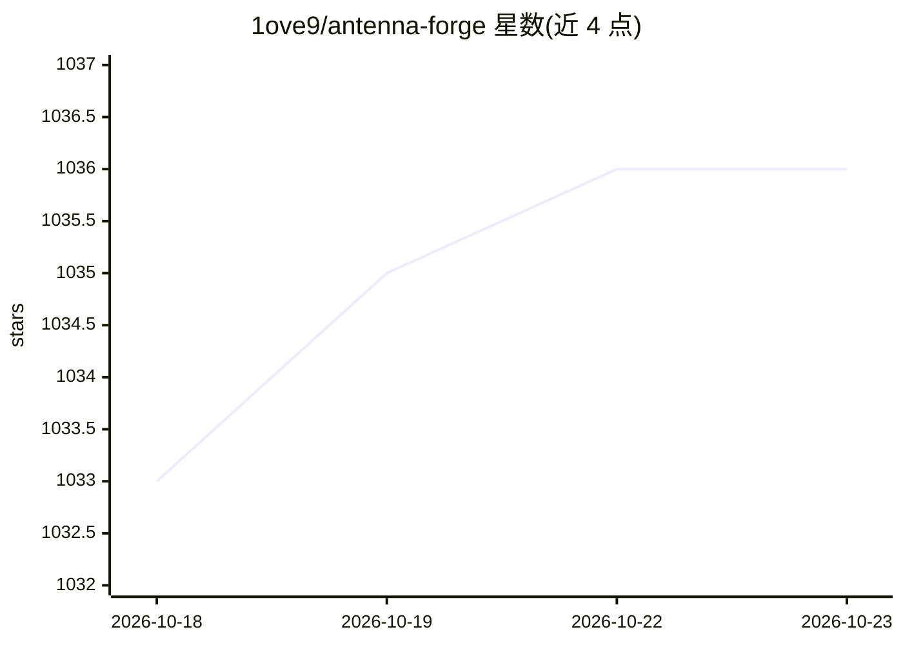

# 1ove9/antenna-forge

⭐ 1,036 · Python · MIT · 推送 2026-06-01 · [GitHub](https://github.com/1ove9/antenna-forge) · [官网](https://1ove9.github.io/antenna-forge/frontend/playground.html) · 个人维护 · 中文 README

**AI 驱动的天线逆向设计平台：真电磁仿真在环的拓扑探索优化**

面向射频/天线工程师的逆向天线设计平台：将真实电磁求解器（NEC2 矩量法经 necpp、openEMS 全波 FDTD）放进优化回路，用差分进化、黄金分割搜索等算法在参数空间中自动收敛出天线设计（如 9 参数八木天线逆向设计），缺失求解器时抛 SolverUnavailable 而非伪造结果。开源核心（MIT）覆盖线天线与平面贴片天线；另设独立的商业增强版。扩散/VAE 等生成模型目前仅为早期实验代码，未接入仿真回路。架构含 FastAPI 服务、Celery 任务队列、React+Three.js 前端。

## 筛选速览

| 维度 | 判定 | 备注 |
|---|---|---|
| AI 角色 | `ai-native` | 本体是模型或模型工具 |
| 许可风险 | `permissive` | MIT |
| 部署形态 | `self-host` | docker 或自建部署 |
| 模型依赖 | — | README 未给出锁定关系 |
| 硬件要求 | — | 无带数字的原话,不猜 |
| 安装摩擦 | `low` | 无编译、无系统依赖或容器化 |
| 成熟度 | `idea` | |

## 能力要点

- 真实 NEC2 / openEMS 求解器在环的经典优化（无解析回退，缺求解器即抛错）
- 9 参数八木-宇田逆向设计案例（5858 次求解调用）
- 半波偶极子与微带贴片已知答案真值校验脚本
- FastAPI + Celery + PostgreSQL/Qdrant + React/Three.js 服务架构

## 适用场景

- 逆向设计线天线或贴片天线并自动验证性能
- 复现八木天线优化基准与真值校验
- 把优化历史数据用作 FNO 代理模型训练集

## 场景标签

 · 领域:射频/电磁工程

## 证据(README 行号)

> L5: **AI-driven antenna invention platform** — automatic exploration, generation,
> L78: The "AI" part of the loop is just differential evolution; the unique
> L79: platform contribution is *what it's optimizing against*: real
> L113: |Solvers|`yaf_solvers/`|openEMS, NEC2, MEEP, HFSS, CST, FEKO|

## 星数曲线

2026-10-18 1,033 → 2026-10-23 1,036（+3）

---
*卡片 v1 · prompt 1.4 · 生成 2026-10-21 · 置信度 high · 依据 README sha `407159136892` · [字段定义](../../DATASET.md)*
