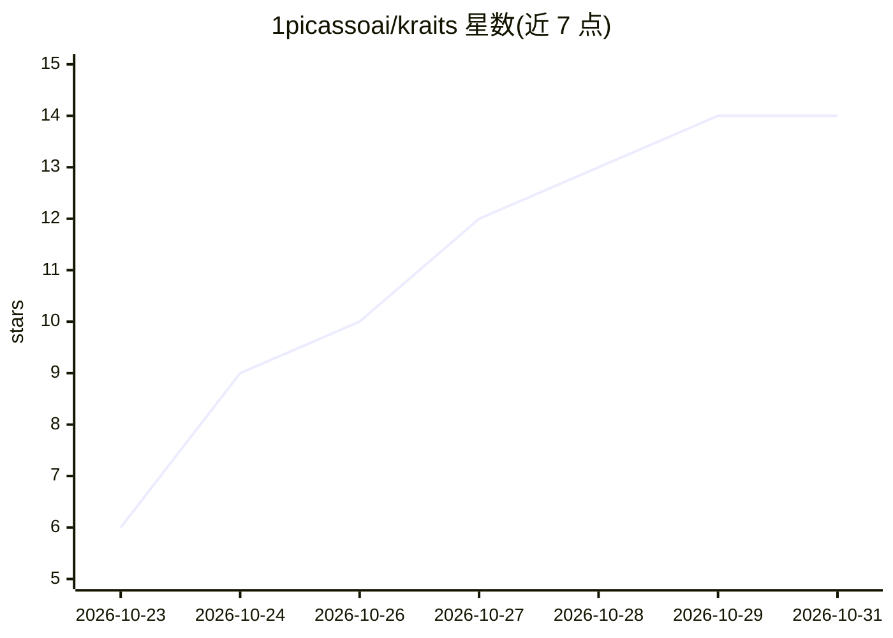

# 1picassoai/kraits

⭐ 14 · Shell · Apache-2.0 · 推送 2026-10-25 · [GitHub](https://github.com/1picassoai/kraits) · 个人维护

**llama.cpp 插件：让 16GB Mac 通过 SSD 流式运行超大 MoE 模型**

不改 llama.cpp 与模型文件的前提下，在 16 GB Apple silicon Mac 上运行超过 GPU 显存容量的混合专家（MoE）模型：Gemma 4 26B-A4B 将每层最热的 80 个专家在加载时放入 GPU，Qwen3.6-35B-A3B 则从 SSD 流式读取专家。默认等待全部专家以保证输出确定性，KRAITS_FAST=1 提速但牺牲一致性。仅支持两个指定模型文件，需 llama.cpp b11715 构建与 macOS 15+，一次一个请求，提供 OpenAI 兼容 API。

## 筛选速览

| 维度 | 判定 | 备注 |
|---|---|---|
| AI 角色 | `ai-ecosystem` | LLM/agent 周边工具 |
| 许可风险 | `permissive` | Apache-2.0 |
| 部署形态 | `None` |  |
| 模型依赖 | local-ok | 支持本地模型 |
| 硬件要求 | — | 无带数字的原话,不猜 |
| 安装摩擦 | `low` | 无编译、无系统依赖或容器化 |
| 成熟度 | — | 结构信号不足 |

## 能力要点

- SSD 流式读取专家，使 22 GB 模型可在 16 GB Mac 上运行
- 默认模式同提示词产出逐字节一致的回答
- Gemma 4 路径按专家热力图将每层最热 80 个专家预载 GPU
- 提供 llama-server 的 OpenAI 兼容 API（端口 8080）

## 适用场景

- 在 16 GB Mac mini 上本地运行 Qwen3.6-35B-A3B 做代码任务
- 本地运行 Gemma 4 26B 进行 TypeScript 编码
- 数据不出本机的本地推理

## 场景标签

`推理引擎` · 领域:训练与推理

## 证据(README 行号)

> L5: A plugin for stock llama.cpp that runs mixture-of-experts models bigger than a 16 GB Mac's GPU can hold. It changes 
> L32: You need an Apple silicon Mac with 16 GB or more on macOS 15 or later, and llama.cpp build b11715 (`llama-b11715-bi

## 星数曲线

2026-10-23 6 → 2026-10-31 14（+8）

---
*卡片 v1 · prompt 1.4 · 生成 2026-10-31 · 置信度 high · 依据 README sha `8c3fa49e3936` · [字段定义](../../DATASET.md)*
