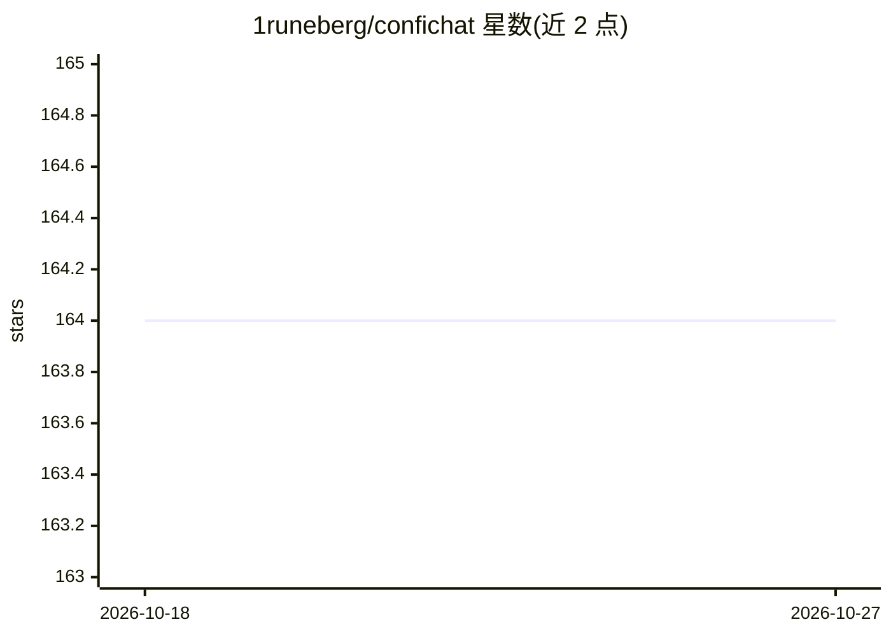

# 1runeberg/confichat

⭐ 164 · Dart · Apache-2.0 · 推送 2026-10-25 · [GitHub](https://github.com/1runeberg/confichat) · [官网](https://codersfollies.com/app/confichat) · 个人维护

**隐私优先的多平台本地 LLM 聊天界面，支持聊天记录加密**

用 Flutter 开发的独立 LLM 聊天客户端，运行于 Windows/Linux/Android/macOS/iOS，无需 Docker 等重型工具。既可完全离线使用本地推理后端（Ollama、LlamaCpp、llmman），也可接入 OpenAI、Anthropic、Gemini 在线 API（使用用户自己的 key）。聊天会话以本地 JSON 文件管理，提供可选的聊天记录与资产加密。各平台提供预构建二进制（macOS/iOS 因平台限制需自行编译），并支持多语言界面与模型交互。

## 筛选速览

| 维度 | 判定 | 备注 |
|---|---|---|
| AI 角色 | `ai-native` | 本体是模型或模型工具 |
| 许可风险 | `permissive` | Apache-2.0 |
| 部署形态 | `None` |  |
| 模型依赖 | local-ok | 支持本地模型 |
| 硬件要求 | — | 无带数字的原话,不猜 |
| 安装摩擦 | `low` | 无编译、无系统依赖或容器化 |
| 成熟度 | — | 结构信号不足 |

## 能力要点

- Flutter 跨平台：Windows/Linux/Android/macOS/iOS
- 本地后端（Ollama/LlamaCpp/llmman）与在线 API（OpenAI/Anthropic/Gemini）均支持
- 聊天记录本地 JSON 管理，可选加密
- 独立应用，无需 Docker，多语言界面

## 适用场景

- 在本地设备离线运行 LLM 聊天，敏感数据不出设备
- 用一个客户端同时切换本地与在线模型
- 在手机上以加密方式保存聊天记录

## 场景标签

`聊天机器人` · 领域:对话与助手

## 证据(README 行号)

> L9:  Welcome to ConfiChat – a multi-platform, privacy-focused LLM chat interface with optional encryption of chat histor
> L36: **ConfiChat** is a lightweight, multi-platform chat interface designed with privacy and flexibility in mind. It sup

## 星数曲线

2026-10-18 164 → 2026-10-27 164（+0）

---
*卡片 v1 · prompt 1.4 · 生成 2026-10-22 · 置信度 high · 依据 README sha `d470f744f215` · [字段定义](../../DATASET.md)*
