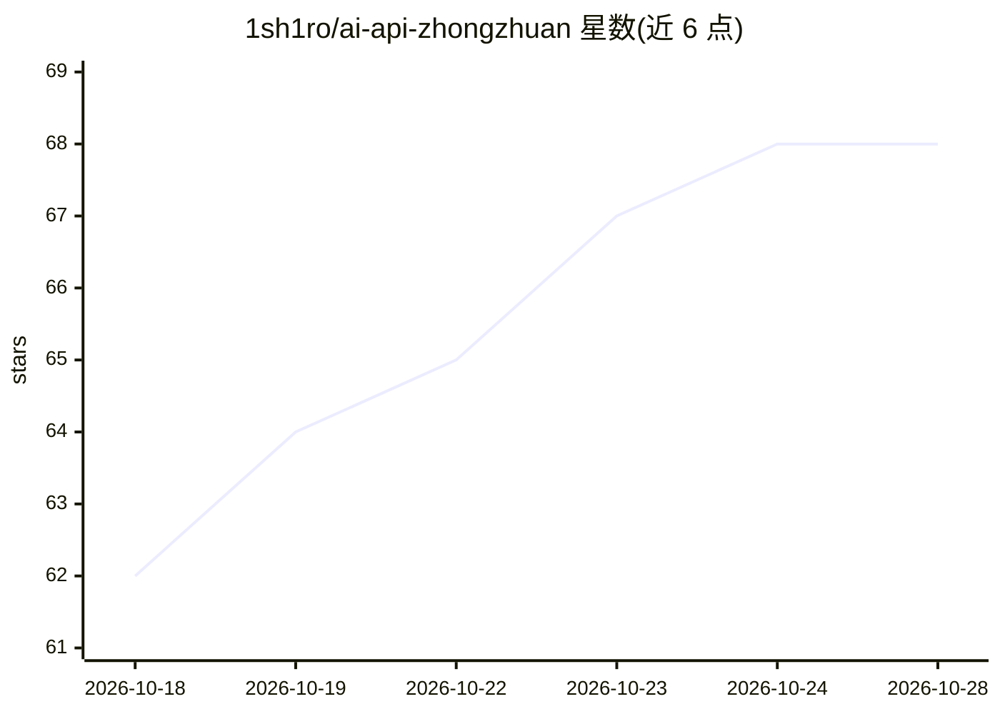

# 1sh1ro/ai-api-zhongzhuan

⭐ 68 · CSS · 推送 2026-10-19 · [GitHub](https://github.com/1sh1ro/ai-api-zhongzhuan) · [官网](https://1sh1ro.github.io/ai-api-zhongzhuan/) · 个人维护 · 中文 README

**AI API 公益站与 Token 中转站导航清单**

按模型生态与能力分类整理的 AI API 中转站聚合目录：覆盖 OpenAI/Codex、Claude、Grok、Gemini、DeepSeek 与国产模型、多模态、综合入口等分类，逐站列出倍率、价格、免费额度与页面核验状态，并标注信息来源（用户提供/本地访问核验/运营方自荐）。包含风险说明：中转站可见转发请求，免费额度与倍率随时变化，多数价格未向厂商独立核验。面向寻找免费或低价 API 入口的中文用户，以 README 清单与网站版形式提供。

## 筛选速览

| 维度 | 判定 | 备注 |
|---|---|---|
| AI 角色 | `ai-knowledge` | 知识聚合/清单类 |
| 许可风险 | `none` | — |
| 部署形态 | `None` |  |
| 模型依赖 | — | README 未给出锁定关系 |
| 硬件要求 | — | 无带数字的原话,不猜 |
| 安装摩擦 | `low` | 无编译、无系统依赖或容器化 |
| 成熟度 | — | 结构信号不足 |

## 能力要点

- 按 GPT/Claude/Grok/Gemini/国产模型等 10 余个分类组织中转站条目
- 逐站记录倍率折算口径与价格快照日期，区分站内倍率与官方价折算
- 标注页面核验状态（可访问/403/Cloudflare 拦截）与信息来源
- 包含中转站数据可见性与价格未独立核验的风险说明

## 适用场景

- 按模型找免费或低价的 API 中转入口
- 横向比较各中转站的倍率与免费额度
- 查看站点当前可用性与核验状态后再选择

## 场景标签

`精选清单` · 领域:学习与行业

## 证据(README 行号)

> L1: # AI API 公益站与 Token 中转站导航
> L3:  按模型生态与能力关键词整理，快速找到适合自己的 API 中转入口
> L34: **维护与使用**　倍率待补充 · 待恢复/人工核验 · 使用说明 · 收录原则 · 风险说明 · ModelRush

## 星数曲线

2026-10-18 62 → 2026-10-28 68（+6）

---
*卡片 v1 · prompt 1.4 · 生成 2026-10-24 · 置信度 high · 依据 README sha `55060558cf6b` · [字段定义](../../DATASET.md)*
