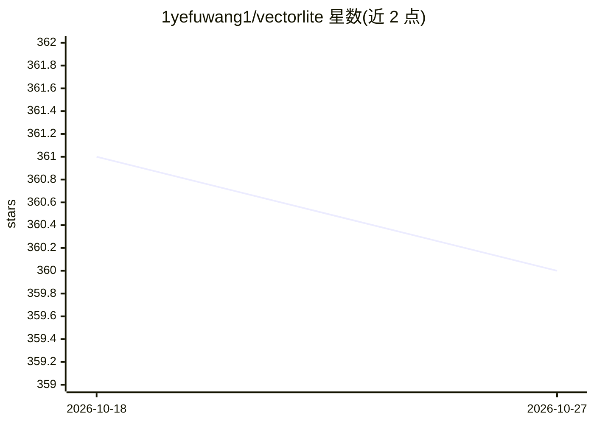

# 1yefuwang1/vectorlite

⭐ 360 · Rust · Apache-2.0 · 推送 2026-10-10 · [GitHub](https://github.com/1yefuwang1/vectorlite) · [官网](https://1yefuwang1.github.io/vectorlite/) · 个人维护

**SQLite 向量搜索扩展：通过 SQL 接口提供基于 HNSW 的 ANN 检索**

面向开发者的 SQLite 可加载扩展，基于 hnswlib 提供近似最近邻（ANN）向量搜索，带 SQL 接口与虚拟表模块，任何具备 SQLite 驱动的语言均可使用。主体实现为 Rust，保留 hnswlib 与 Google Highway SIMD 的原生 C++ 部分。支持 Linux x64、Windows x64 与 macOS Apple Silicon，提供 Python wheel 与 npm 包。支持 l2/cosine/ip 距离、float32/float16/bfloat16 存储、谓词下推、索引显式持久化与加载 hnswlib 旧格式索引。项目自述处于 beta，可能有不兼容变更；官方支持平台不含 Intel macOS。

## 筛选速览

| 维度 | 判定 | 备注 |
|---|---|---|
| AI 角色 | `ai-ecosystem` | LLM/agent 周边工具 |
| 许可风险 | `permissive` | Apache-2.0 |
| 部署形态 | `library` | 以包/库形式分发 |
| 模型依赖 | — | README 未给出锁定关系 |
| 硬件要求 | — | 无带数字的原话,不猜 |
| 安装摩擦 | `medium` | 含编译或系统依赖之一 |
| 成熟度 | `idea` | |

## 能力要点

- hnswlib 支撑的 ANN 向量搜索虚拟表，SQL 接口操作
- SIMD 加速的向量距离实现，支持 l2/cosine/ip 三种距离
- 谓词下推的 rowid 元数据过滤（需 SQLite ≥ 3.38）
- 索引可显式保存/加载，兼容 hnswlib 旧格式索引文件

## 适用场景

- 在现有 SQLite 应用中嵌入向量检索而无需独立向量数据库
- 配合任意带 SQLite 驱动的语言做 embedding 的 ANN 查询
- 通过 SQL 完成向量插入、更新与 KNN 查询

## 场景标签

`向量数据库` · 领域:知识与检索

## 证据(README 行号)

> L5: Vectorlite is a Runtime-loadable extension for SQLite that enables fast vector search based on hnswlib and works on 
> L7: **Rust is the main and only extension implementation.** The Cargo crate owns the SQLite virtual table, scalar functi
> L60: The core of vectorlite is the virtual table module, which is used to hold vector index and way faster than brute fo

## 星数曲线

2026-10-18 361 → 2026-10-27 360（-1）

---
*卡片 v1 · prompt 1.4 · 生成 2026-10-21 · 置信度 high · 依据 README sha `5f491202d14b` · [字段定义](../../DATASET.md)*
