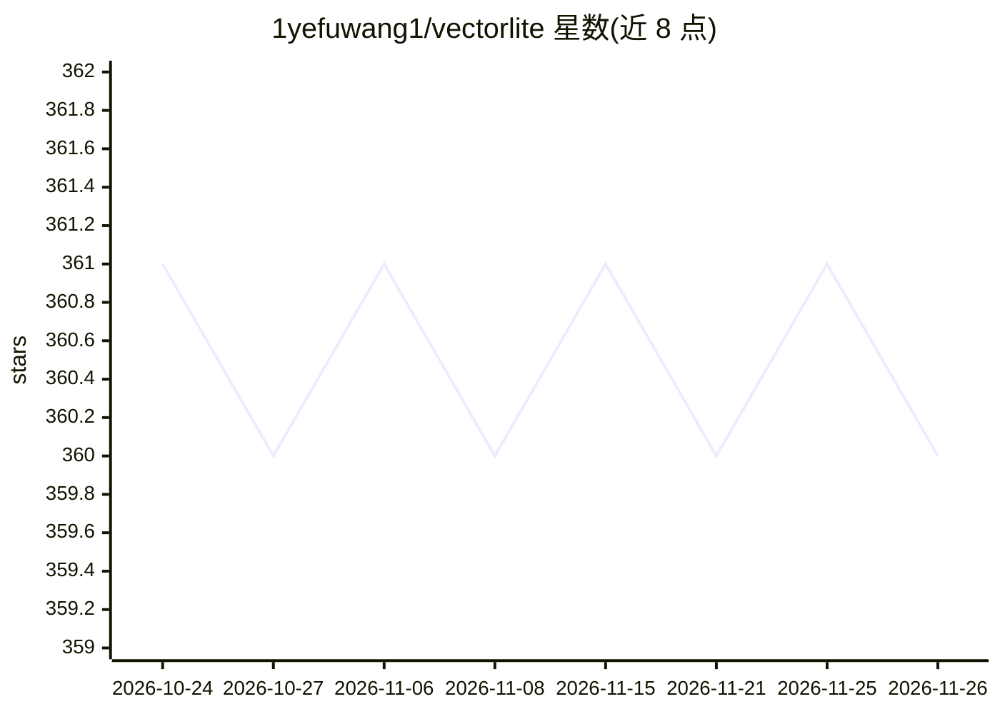

# 1yefuwang1/vectorlite

⭐ 360 · Rust · Apache-2.0 · 推送 2026-11-25 · [GitHub](https://github.com/1yefuwang1/vectorlite) · [官网](https://1yefuwang1.github.io/vectorlite/) · 个人维护

**SQLite 向量检索扩展：让任意语言用 SQL 做 ANN 搜索**

Vectorlite 是一个可运行时加载的 SQLite 扩展，基于 hnswlib 提供 ANN 向量搜索，以 SQL 接口暴露，任何带 SQLite 驱动的语言均可调用。官方发布覆盖 Linux x64、Windows x64 与 macOS Apple Silicon，通过 Python wheel 与 npm 包分发；扩展主体以 Rust 实现，保留 hnswlib 与 Google Highway SIMD 的原生代码。功能包括 l2/cosine/ip 距离、HNSW 参数调优、rowid 谓词下推过滤、索引保存/加载（含 hnswlib 旧索引文件）、JSON 向量序列化，以及实验性的 SQLite-backed DiskANN 事务后端。当前为 beta，README 声明可能存在破坏性变更。

## 筛选速览

| 维度 | 判定 | 备注 |
|---|---|---|
| AI 角色 | `ai-ecosystem` | LLM/agent 周边工具 |
| 许可风险 | `permissive` | Apache-2.0 |
| 部署形态 | `library` | 以包/库形式分发 |
| 模型依赖 | — | README 未给出锁定关系 |
| 硬件要求 | — | 无带数字的原话,不猜 |
| 安装摩擦 | `medium` | 含编译或系统依赖之一 |
| 成熟度 | `idea` | |

## 能力要点

- 基于 hnswlib 的 ANN 搜索，支持 l2/cosine/ip 距离与 HNSW 参数调优
- SQL 接口的虚拟表模块，任何带 SQLite 驱动的语言可用
- 索引显式 save/load（带版本化封装），兼容 hnswlib 原始索引文件
- 实验性 diskann() 后端：事务性增删改与显式 consolidation

## 适用场景

- 在已有 SQLite 应用里加入向量近邻搜索能力
- 多语言项目复用同一份向量索引文件
- 管理 RAG 场景下的 embedding 存储与 KNN 查询
- 需要按 rowid 元数据过滤向量检索结果的场景

## 场景标签

`向量数据库` · 领域:知识与检索

## 证据(README 行号)

> L5: Vectorlite is a Runtime-loadable extension for SQLite that enables fast vector search based on hnswlib and works on 
> L83: The core of vectorlite is the virtual table module, which is used to hold vector index and way faster than brute fo

## 星数曲线

2026-10-24 361 → 2026-11-26 360（-1）

---
*卡片 v1 · prompt 1.4 · 生成 2026-11-26 · 置信度 mid · 依据 README sha `478dd9b36dea` · [字段定义](../../DATASET.md)*
