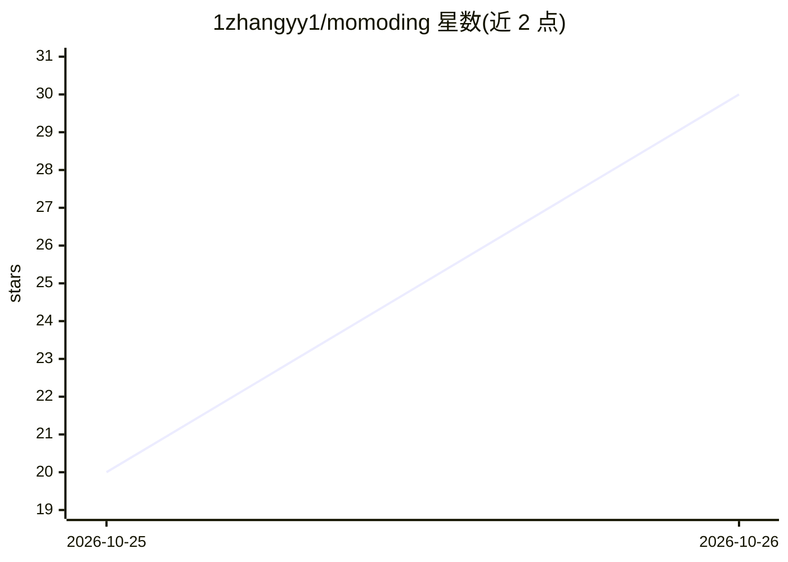

# 1zhangyy1/momoding

⭐ 30 · Kotlin · GPL-3.0 · 推送 2026-10-24 · [GitHub](https://github.com/1zhangyy1/momoding) · 个人维护 · 中文 README

**安卓手机上的个人 AI Agent：一句话代办手机上的事**

安装到安卓手机的开源 Personal Agent 应用（Android 8+，APK 分发，GPLv3）：通过对话交代任务，由 Agent 读取日历、闹钟、通讯录、通知、截图等手机数据，代为创建日程、提醒、草稿短信、查询信息，并可记住用户偏好、执行例行定时任务；实验性支持经无障碍权限操作其他 App。数据存本地（对话/记忆/规则），无账号服务器，但调用模型时会把相关内容发给用户自选的模型服务（预设 DeepSeek、Kimi、通义千问、智谱 GLM、豆包、硅基流动等，也支持 OpenAI、Claude、Gemini、OpenRouter）；搜索用 Exa。自带 Linux 沙箱（PRoot/FFmpeg/LAME/rclone），需从源码构建；自述为 1.0 预览版，仍在快速迭代，主要在模拟器和少数真机上打磨。基于上游 OpenMinis 开发，无维护的 iOS 版。

## 筛选速览

| 维度 | 判定 | 备注 |
|---|---|---|
| AI 角色 | `ai-native` | 本体是模型或模型工具 |
| 许可风险 | `viral` | GPL-3.0 |
| 部署形态 | `None` |  |
| 模型依赖 | locked-api |  |
| 硬件要求 | — | 无带数字的原话,不猜 |
| 安装摩擦 | `medium` | 含编译或系统依赖之一 |
| 成熟度 | `idea` | |

## 能力要点

- 对话交代即可代办日程、提醒、短信草稿、信息查询等手机事务
- 记忆用户偏好并按其自动执行，例行任务定时汇报
- 实验性经无障碍权限代操作其他 App（屏幕上有胶囊提示，可随时停止）
- 本地优先：无账号无服务器，对话、记忆、规则存手机上；模型服务由用户自选

## 适用场景

- 用一句话把会议截图转成日历日程和提醒
- 让 Agent 每天定时汇报要紧事项、盯着页面变化
- 授权后让 Agent 在手机上替自己操作 12306 等其他 App

## 场景标签

`AI 助手` `GUI 自动化` · 领域:效率与自动化

## 证据(README 行号)

> L5:  把你的手机变成 AI 手机。
> L7: 看到什么、想到什么，交代一句，它用手机上的东西帮你办好，记住你的习惯，替你盯着后续。
> L104: 2. 打开 Momoding，选一家模型服务，填入你的 API Key。首次使用预设了：
> L105:  **DeepSeek**（好用不贵）、**Kimi**、**通义千问**、**智谱 GLM**、**豆包**、**硅基流动**；也支持 OpenRouter、OpenAI、Claude、Gemini 等。

## 星数曲线

2026-10-25 20 → 2026-10-26 30（+10）

---
*卡片 v1 · prompt 1.4 · 生成 2026-10-26 · 置信度 high · 依据 README sha `6b178ae5f93f` · [字段定义](../../DATASET.md)*
