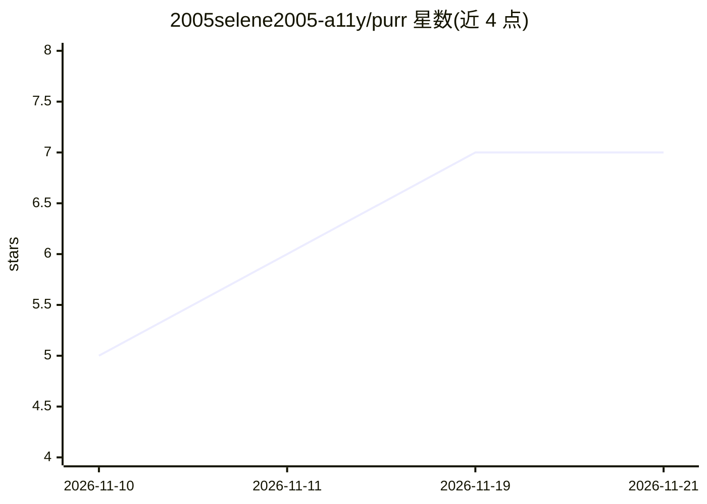

# 2005selene2005-a11y/purr

⭐ 7 · Python · MIT · 推送 2026-11-09 · [GitHub](https://github.com/2005selene2005-a11y/purr) · 个人维护 · 中文 README

**给 AI 一个微信式聊天页：拆条、已读、撤回、朋友圈与便签记忆**

基于 FastAPI/LLM 的 AI 陪伴聊天应用：模拟真人消息节奏（已读回执、正在输入、按长度模拟打字时间、拆条发送、手滑撤回、生成中重写），配合分层记忆机制（最近 40 条原文 + 8 小时内摘要 + 定期便签 + [REMEMBER] 长期记忆）。附带朋友圈互动、主动消息、虚拟红包、表情包、可选 vision 看图。数据存本地 SQLite，支持手机浏览器添加到主屏幕当 App 使用，公网部署需设置 access_key。

## 筛选速览

| 维度 | 判定 | 备注 |
|---|---|---|
| AI 角色 | `ai-native` | 本体是模型或模型工具 |
| 许可风险 | `permissive` | MIT |
| 部署形态 | `library` | 以包/库形式分发 |
| 模型依赖 | local-ok | 支持本地模型 |
| 硬件要求 | — | 无带数字的原话,不猜 |
| 安装摩擦 | `low` | 无编译、无系统依赖或容器化 |
| 成熟度 | — | 结构信号不足 |

## 能力要点

- 真人化消息节奏：等你说完、拆条模拟打字时间、手滑撤回（概率可调）
- 分层记忆：近期原文 + 时间窗摘要 + 便签 + [REMEMBER] 长期记忆
- 朋友圈机制：AI 每天随机发 0～2 条，会对你的朋友圈点赞评论
- mock 模式无 API key 可先体验界面，任意 OpenAI 兼容接口可用

## 适用场景

- 自托管一个有真人聊天节奏的 AI 陪伴应用
- 用自己的 OpenRouter/DeepSeek/本地 Ollama 模型跑陪伴对话
- 给 AI 配人设和记忆，让它记住约定与偏好

## 场景标签

`聊天机器人` · 领域:对话与助手

## 证据(README 行号)

> L3: **让你的 AI 住进一个像微信的聊天页里，像真人一样跟你发消息。**
> L5: 市面上的 AI 陪伴，大多是“你一句，它一大段”。purr 想做的是另一种感觉：它会**已读**，会**正在输入…**，会把话拆成几条短消息慢慢发；你连发三条，它等你说完再一起回；它偶尔手滑发出半句又撤回；你几个小时不理它，它会主动
> L62: 任何 OpenAI 兼容接口都可以。`notes_model` 可以填一个便宜的模型，专门写便签和朋友圈。key 也可以不写进文件，用环境变量 `PURR_API_KEY`。

## 星数曲线

2026-11-10 5 → 2026-11-21 7（+2）

---
*卡片 v1 · prompt 1.4 · 生成 2026-11-20 · 置信度 high · 依据 README sha `7b278c10507e` · [字段定义](../../DATASET.md)*
