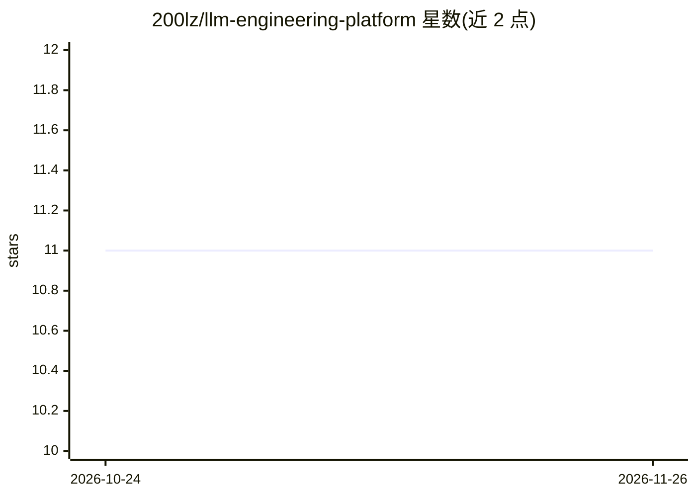

# 200lz/llm-engineering-platform

⭐ 11 · Python · MIT · 推送 2026-07-26 · [GitHub](https://github.com/200lz/llm-engineering-platform) · 个人维护

**面向工程实践者的本地 LLM 平台：网关/评测/实验/RAG 四件套**

基于 FastAPI 与 llama.cpp 后端的 LLM 工程平台，提供四个独立可用的部分：OpenAI 兼容的流式网关、确定性评测与回归 CLI（llm-eval）、带校验和的本地实验注册库（llm-experiment）、以及带指纹与引用的本地 RAG 工具包（llm-rag）。推理依赖单独运行的 llama-server 与 GGUF 模型；默认测试无需模型、GPU 或数据库。README 自述为参考/教学型项目，网关默认无鉴权且仅绑定 loopback，不提供多模型路由或分布式协调。

## 筛选速览

| 维度 | 判定 | 备注 |
|---|---|---|
| AI 角色 | `ai-ecosystem` | LLM/agent 周边工具 |
| 许可风险 | `permissive` | MIT |
| 部署形态 | `self-host` | docker 或自建部署 |
| 模型依赖 | local-ok | 支持本地模型 |
| 硬件要求 | `cpu-ok` | |
| 安装摩擦 | `low` | 无编译、无系统依赖或容器化 |
| 成熟度 | — | 结构信号不足 |

## 能力要点

- OpenAI 兼容 FastAPI 网关：缓冲与 SSE 增量流式、取消、Prometheus 指标
- 确定性评测与手动回归门禁（llm-eval，报告为 JSON/Markdown）
- 不可变实验注册库，工件含 SHA-256 与字节大小元数据
- 全本地 RAG 工具链：注册、分块、索引、检索、结构化引用与 P@K/MRR 指标

## 适用场景

- 在本地为 llama.cpp 模型提供 OpenAI 兼容的流式服务接口
- 为 LLM 服务建立数据集化评测与回归基线
- 以可复现方式登记和比较 LLM 实验运行
- 在纯本地环境构建带引用溯源的 RAG 检索管线

## 场景标签

`模型网关` `模型评测` `RAG` `MLOps` · 领域:Agent 开发

## 证据(README 行号)

> L10: A production-oriented, CPU-first LLM engineering platform built around
> L23: - an OpenAI-shaped FastAPI gateway for a separately running `llama-server`;
> L49: It is a reference and portfolio project, not a replacement for vLLM, SGLang,

## 星数曲线

2026-10-24 11 → 2026-11-26 11（+0）

---
*卡片 v1 · prompt 1.4 · 生成 2026-11-19 · 置信度 high · 依据 README sha `f92ae478eb79` · [字段定义](../../DATASET.md)*
