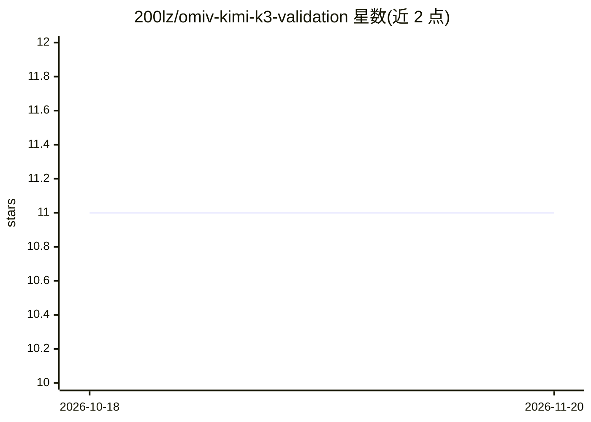

# 200lz/omiv-kimi-k3-validation

⭐ 11 · Shell · Apache-2.0 · 推送 2026-07-30 · [GitHub](https://github.com/200lz/omiv-kimi-k3-validation) · 个人维护

**用 OMIV 对 Kimi K3 两种量化 GGUF 做结构校验的报告**

该仓库是 OMIV 校验运行的公开案例研究报告：在不下载张量负载的前提下，对 unsloth/Kimi-K3-GGUF 在固定制品修订上的 UD-IQ1_M 与 UD-Q4_K_XL 两种分片 GGUF 变体做结构校验，给出有界报告、确定性摘要、证据元数据与验证脚本。结论为两者均含 2,573 个描述符且形状匹配，标注为带限制的结构校验通过；制品溯源不可用，数值正确性、量化保真度等均未检查。文本内容为 CC BY 4.0，验证脚本为 Apache 2.0。

## 筛选速览

| 维度 | 判定 | 备注 |
|---|---|---|
| AI 角色 | `ai-knowledge` | 知识聚合/清单类 |
| 许可风险 | `permissive` | Apache-2.0 |
| 部署形态 | `None` |  |
| 模型依赖 | — | README 未给出锁定关系 |
| 硬件要求 | — | 无带数字的原话,不猜 |
| 安装摩擦 | `low` | 无编译、无系统依赖或容器化 |
| 成熟度 | — | 结构信号不足 |

## 能力要点

- 零张量负载下载的远端结构校验（2,573 个描述符比对）
- 发布确定性摘要与 digest 关联的证据元数据
- 附可复现的验证 shell 脚本
- 明确列出证据局限与未检查项

## 适用场景

- 分片 GGUF 发布后在完整下载前做结构核验
- 复核两种量化变体间描述符与形状的一致性
- 参考 OMIV 校验输出的报告格式组织证据元数据

## 场景标签

 · 领域:LLM 基础设施/模型完整性校验

## 证据(README 行号)

> L1: # Kimi K3 GGUF Structural Validation Report
> L6: This case study records evidence-backed structural validation of two split GGUF
> L31: This repository contains the public case-study report, evidence summaries, and

## 星数曲线

2026-10-18 11 → 2026-11-20 11（+0）

---
*卡片 v1 · prompt 1.4 · 生成 2026-11-19 · 置信度 high · 依据 README sha `154a09b6ea42` · [字段定义](../../DATASET.md)*
