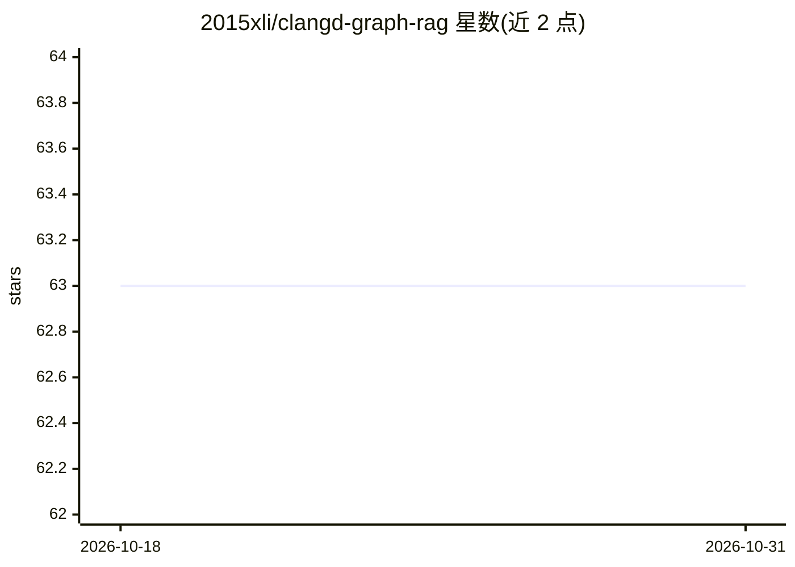

# 2015xli/clangd-graph-rag

⭐ 63 · Python · Apache-2.0 · 推送 2026-04-25 · [GitHub](https://github.com/2015xli/clangd-graph-rag) · 个人维护

**C/C++ 源码知识图谱构建工具：把 Clang/Clangd 索引转为 Neo4j GraphRAG**

基于 clang/clangd 解析 C/C++ 项目，融合 Clangd 索引与 Clang 解析数据，导入 Neo4j 重建文件/符号/调用链等完整层级，并用 LLM 生成摘要与向量嵌入构成知识图谱，供 MCP 服务器与示例 AI agent 做代码分析、重构建议与架构审查。支持基于 git diff 的增量更新，可处理 Linux 内核等大型代码库（基准：12 核 64GB 内存工作站约 4 小时）。运行依赖 clang(≥21)、Neo4j(≥5, 含 APOC 插件)、compile_commands.json、clangd-indexer 索引文件与 LLM API（经 LiteLLM 接入，支持 Ollama 本地服务）；示例 agent 需 Python 3.13 + Google ADK。

## 筛选速览

| 维度 | 判定 | 备注 |
|---|---|---|
| AI 角色 | `ai-ecosystem` | LLM/agent 周边工具 |
| 许可风险 | `permissive` | Apache-2.0 |
| 部署形态 | `library` | 以包/库形式分发 |
| 模型依赖 | local-ok | 支持本地模型 |
| 硬件要求 | — | 无带数字的原话,不猜 |
| 安装摩擦 | `medium` | 含编译或系统依赖之一 |
| 成熟度 | — | 结构信号不足 |

## 能力要点

- 融合 Clangd 索引与 Clang 解析数据构建 Neo4j 代码知识图谱
- AI 生成摘要与向量嵌入增强图谱语义
- 基于 git commit diff 的增量更新，避免全量重建
- 提供示例 MCP 服务器与 AI expert agent

## 适用场景

- 为大型 C/C++ 代码库建立可查询的知识图谱做深度分析
- 让 AI agent 通过图谱理解调用链与架构并给出重构建议
- 配合 MCP 把代码图谱接入编码助手

## 场景标签

`知识图谱` `RAG` · 领域:知识与检索

## 证据(README 行号)

> L3: This project builds a Neo4j graph RAG (Retrieval-Augmented Generation) for a C/C++ software project based on clang/c
> L5: The project includes an example MCP server and an AI expert agent. You can also develop your own MCP servers and age
> L36: This project fills that gap. It reconciles the Clangd index data and Clang parsing data, and ingests them into a Ne

## 星数曲线

2026-10-18 63 → 2026-10-31 63（+0）

---
*卡片 v1 · prompt 1.4 · 生成 2026-10-24 · 置信度 mid · 依据 README sha `4b9f24e58943` · [字段定义](../../DATASET.md)*
