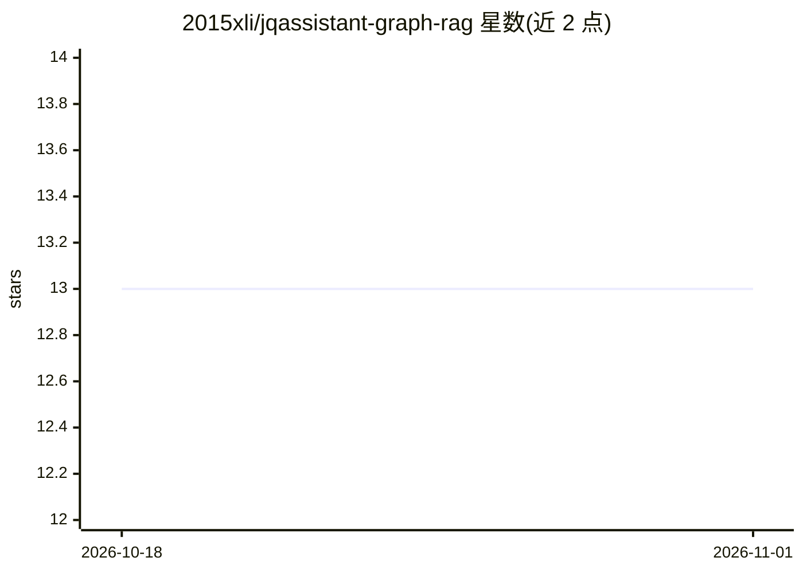

# 2015xli/jqassistant-graph-rag

⭐ 13 · Python · Apache-2.0 · 推送 2026-02-07 · [GitHub](https://github.com/2015xli/jqassistant-graph-rag) · 个人维护

**将 jQAssistant 代码图增强为语义化 Graph RAG 供 AI agent 查询**

面向 Java/Kotlin 开发者的代码知识图谱构建工具：读取 jQAssistant 生成的 Neo4j 字节码图，解析源代码后叠加源码结构与类层次两层覆盖图，再按依赖顺序自底向上调用 LLM 为方法、类型、文件、目录、包到整个项目生成多级摘要，形成可查询的 Graph RAG。摘要带缓存，增量处理避免重复调用。另附 MCP 工具服务器与 Google ADK 示例 agent，支持通过 Cypher 查询和自然语言问答。限制：需先自行安装 jQAssistant 并扫描出图，项目需同时含源码与编译产物。

## 筛选速览

| 维度 | 判定 | 备注 |
|---|---|---|
| AI 角色 | `ai-ecosystem` | LLM/agent 周边工具 |
| 许可风险 | `permissive` | Apache-2.0 |
| 部署形态 | `library` | 以包/库形式分发 |
| 模型依赖 | local-ok | 支持本地模型 |
| 硬件要求 | — | 无带数字的原话,不猜 |
| 安装摩擦 | `low` | 无编译、无系统依赖或容器化 |
| 成熟度 | — | 结构信号不足 |

## 能力要点

- 在 jQAssistant 图上叠加源码结构与类层次两个覆盖图
- 自底向上依赖感知的多级 LLM 摘要生成，支持 token 分块
- 摘要缓存与可恢复的增量处理
- 附带 MCP 工具服务器与 Google ADK 示例 agent

## 适用场景

- 为代码问答 agent 构建带语义摘要的代码知识图谱
- 通过 MCP 服务器让 AI agent 查询代码库架构与设计意图
- 分析大型 Java/Kotlin 项目的组件职责与调用工作流

## 场景标签

`知识图谱` `RAG` · 领域:知识与检索

## 证据(README 行号)

> L26: 2. **RAG Generation**: It walks the entire enriched graph in a structured, bottom-up manner, using a Large Language
> L109: Once the code graph is built and enriched, you can interact with it using natural language through an AI agent. Th

## 星数曲线

2026-10-18 13 → 2026-11-01 13（+0）

---
*卡片 v1 · prompt 1.4 · 生成 2026-10-31 · 置信度 mid · 依据 README sha `e25c979fcb71` · [字段定义](../../DATASET.md)*
