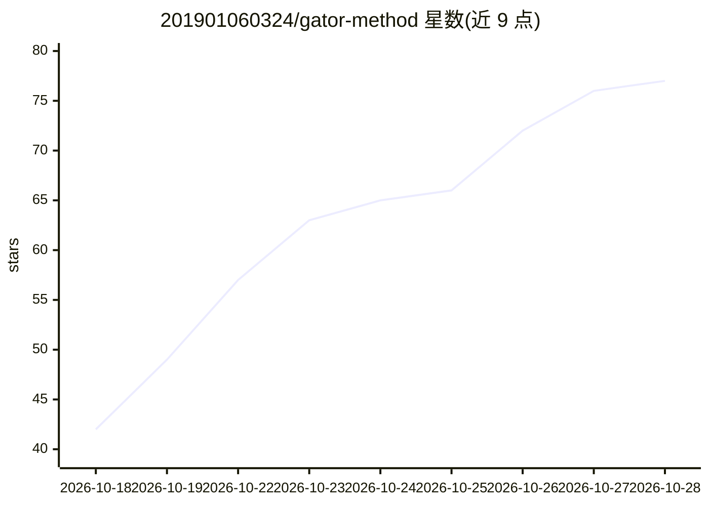

# 201901060324/gator-method

⭐ 80 · HTML · NOASSERTION · 推送 2026-10-24 · [GitHub](https://github.com/201901060324/gator-method) · [官网](https://201901060324.github.io/gator-method/) · 个人维护 · 中文 README

**从 A 股博主四年公开内容提炼的可检索判断规则知识库**

将复盘博主「像鳄鱼一样思考」四年的 700+ 篇文章、80 场左右直播与体系长文，提炼为结构化的世界观、决策流程、判断规则与语言风格文档；模糊经验被翻译为带数字阈值的 IF…THEN 规则，部分信号做过有限的历史行情回测对齐。面向想研究其方法论或接入 AI 助手的个人学习者；README 明确声明素材时间分布不均（2024 年缺口）、不构成投资建议，公开版 55 个编号中 50 章可阅读。

## 筛选速览

| 维度 | 判定 | 备注 |
|---|---|---|
| AI 角色 | `ai-knowledge` | 知识聚合/清单类 |
| 许可风险 | `none` | NOASSERTION |
| 部署形态 | `None` |  |
| 模型依赖 | — | README 未给出锁定关系 |
| 硬件要求 | — | 无带数字的原话,不猜 |
| 安装摩擦 | `low` | 无编译、无系统依赖或容器化 |
| 成熟度 | — | 结构信号不足 |

## 能力要点

- 703 篇文章与历史行情日期对齐，部分信号有跨阶段历史检验
- 规则形式化为带数字阈值的 IF…THEN 条件，部分标注 [可计算]
- 55 个编号、按章拆分独立文件，便于检索与 AI 逐章引用
- 前瞻记分板逐条登记事前判断与事后走势，git 提交时间可核对

## 适用场景

- 研究该博主四年 A 股判断方法的结构化笔记
- 把规则体系接入 DeepSeek/Claude/ChatGPT 等 AI 作为系统提示或知识库
- 核对具体判断规则的历史行情对齐证据

## 场景标签

`金融量化` `知识库管理` · 领域:知识与检索

## 证据(README 行号)

> L3: 把一个 A 股复盘博主（公众号「像鳄鱼一样思考」/「获得信息差」，B 站同名）**四年公开内容**，
> L24: 3. **把模糊的经验翻译成 `IF…THEN…` 规则，尽量带上数字阈值**

## 星数曲线

2026-10-18 42 → 2026-10-28 77（+35）

---
*卡片 v1 · prompt 1.4 · 生成 2026-10-24 · 置信度 high · 依据 README sha `d6f7f503398d` · [字段定义](../../DATASET.md)*
