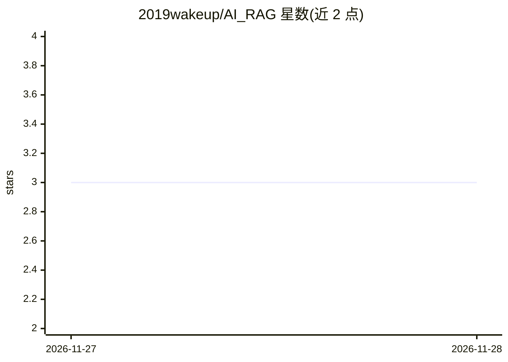

# 2019wakeup/AI_RAG

⭐ 3 · TypeScript · MIT · 推送 2026-11-27 · [GitHub](https://github.com/2019wakeup/AI_RAG) · 组织维护 · 中文 README

**面向沥青路面养护材料的带证据引用与可信拒答知识库问答系统**

研究生课程设计项目：在 11,143 块/395 文档的沥青路面养护材料语料上做 BM25（SQLite FTS5 trigram）+ 向量（LanceDB，Xenova/multilingual-e5-small）混合检索，RRF(k=60) 融合，返回带 [n] 角标、可展开原文证据的答案，证据不足时拒答、信息不足时追问。架构为 Vue 3 前端 + Hono API + 可选 LLM（默认 DeepSeek），无 LLM 时降级为抽取式答案，嵌入或向量库失败时降级 BM25 或 SQLite 后端。当前问答后端链路与前端页面已具备，拒答/追问接入编排等仍为待交付项。

## 筛选速览

| 维度 | 判定 | 备注 |
|---|---|---|
| AI 角色 | `ai-native` | 本体是模型或模型工具 |
| 许可风险 | `permissive` | MIT |
| 部署形态 | `None` |  |
| 模型依赖 | — | README 未给出锁定关系 |
| 硬件要求 | — | 无带数字的原话,不猜 |
| 安装摩擦 | `low` | 无编译、无系统依赖或容器化 |
| 成熟度 | `idea` | |

## 能力要点

- BM25 + 向量混合检索（RRF 融合），38 条金标准上 mean recall@5 0.9187
- 答案带 [n] 角标双向校验的原文证据引用，每块语料含 7 字段 provenance
- 无 LLM/余额不足时降级抽取式答案，嵌入或 LanceDB 失败时逐级降级保持可用
- 486 项单测、OpenAPI 3.1 文档与 GitHub Actions CI

## 适用场景

- 查询沥青路面养护材料的规范条文与论文依据并获得原文出处
- 在领域语料上实现证据不足即拒答的问答交互
- 复现检索方案对比实验（纯 BM25 / 纯向量 / 混合 RRF）

## 场景标签

`文档问答` `RAG` · 领域:知识与检索

## 证据(README 行号)

> L8: **一句话**：输入一个用自然语言提出的材料问题，系统在 11,143 块领域语料中做 BM25 + 向量混合检索，返回**带 `[n]` 角标、可展开原文**的答案；证据不足时**明确拒答**，信息不足时**追问**——而不是编造
> L130: - **问答链路（后端）**：`/api/v1/qa` 已打通 检索 → 证据选择（相关度主序、原文 snippet、3–8 条）→ 生成 → `[n]` 双向校验（越界剔除）；`/api/v1/qa/stream` 提供 SS
> L177: - **第三方**：transformers.js、Xenova 嵌入模型、LanceDB、SQLite FTS5、Hono、Vue 生态等遵循各自许可；LLM 服务（默认 DeepSeek）受服务方条款约束。

## 星数曲线

2026-11-27 3 → 2026-11-28 3（+0）

---
*卡片 v1 · prompt 1.4 · 生成 2026-11-27 · 置信度 high · 依据 README sha `38322e846471` · [字段定义](../../DATASET.md)*
