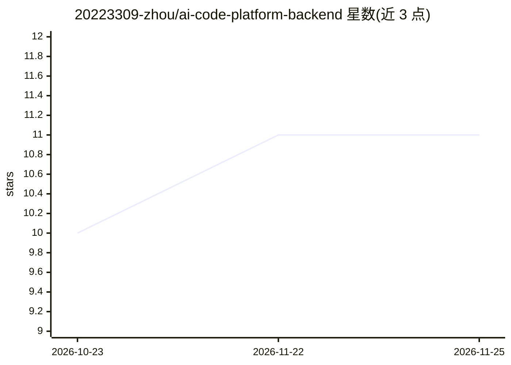

# 20223309-zhou/ai-code-platform-backend

⭐ 11 · Java · MIT · 推送 2026-11-22 · [GitHub](https://github.com/20223309-zhou/ai-code-platform-backend) · [官网](http://icodeplay.site/) · 个人维护 · 中文 README

**开发者自然语言生成可部署网页应用的 Java 后端平台**

本仓库为单体版后端，基于 Java 21 + Spring Boot + LangChain4j + MyBatis-Flex 构建：用户输入自然语言需求，系统由路由模型判定产出单文件 HTML、多文件页面、Vue 或 React 工程，经流式输出逐段返回前端，支持多轮对话式局部修改、图片/文本多模态参考资料输入，以及 RAG 知识库（已部署项目按生成类型动态过滤检索）。功能调用含文件读写修改、网页抓取与 Skills 技能系统，另提供应用预览、一键部署、模板广场、积分/VIP 额度与管理后台。运行需 JDK 21、MySQL 主从、Redis，可选 Qdrant，完整跑通还需大模型 API Key 等外部配置。

## 筛选速览

| 维度 | 判定 | 备注 |
|---|---|---|
| AI 角色 | `ai-native` | 本体是模型或模型工具 |
| 许可风险 | `permissive` | MIT |
| 部署形态 | `library` | 以包/库形式分发 |
| 模型依赖 | locked-api |  |
| 硬件要求 | — | 无带数字的原话,不猜 |
| 安装摩擦 | `medium` | 含编译或系统依赖之一 |
| 成熟度 | — | 结构信号不足 |

## 能力要点

- 生成类型自动路由（单文件/多文件/Vue/React 工程），独立轻量模型做方案预选并失败降级
- RAG 知识库：bge-small-zh-v1.5 嵌入，按生成类型 dynamicFilter 检索，Qdrant 或 InMemory 可选
- Function Calling：文件读写/局部修改工具、网页抓取工具与 Skills 技能按需加载
- 流式输出含思考过程与工具调用消息，支持 StreamingHandle.cancel 源头截断并终止计费

## 适用场景

- 描述业务需求生成可运行、可迭代、可部署的网页应用
- 以多轮对话方式局部修改已生成的前端工程
- 检索已部署同类项目的实现作为生成参考
- 封装为 Windows 桌面端多窗口并行生成

## 场景标签

`代码生成` `RAG` · 领域:编码与开发

## 证据(README 行号)

> L5:  一句话描述需求，AI 直接生成可运行、可迭代、可部署的网页应用
> L67: - **生成类型自动路由**：由路由模型判断该产出单文件 HTML、多文件页面、Vue 工程还是 React 工程，用户也可手动指定
> L104: |AI|LangChain4j 1.15 · Qdrant 1.17 · bge-small-zh-v1.5|

## 星数曲线

2026-10-23 10 → 2026-11-25 11（+1）

---
*卡片 v1 · prompt 1.4 · 生成 2026-11-20 · 置信度 high · 依据 README sha `4e3fe3b12ef7` · [字段定义](../../DATASET.md)*
