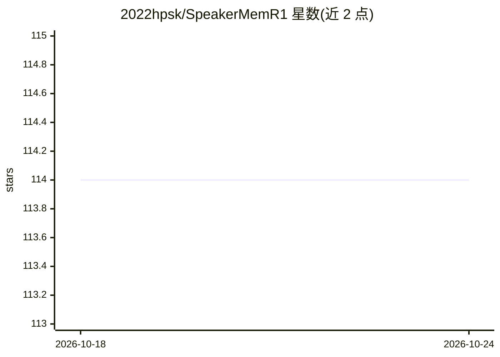

# 2022hpsk/SpeakerMemR1

⭐ 103 · Python · MIT · 推送 2026-09-24 · [GitHub](https://github.com/2022hpsk/SpeakerMemR1) · [官网](https://2022hpsk.github.io/SpeakerMemR1/) · 组织维护

**多方对话的以说话者为中心双轨记忆研究框架**

论文配套研究代码库：SpeakerMem-R1 将多方对话记忆分为两条轨道——System 1 逐字保存带说话者与时间元数据的消息，System 2 由 Writer 模型生成 ADD/UPDATE/NOOP 动作，组织出个人与群体层的结构化记忆；查询时按说话者、范围、时间约束组合证据供回答模型使用。提供推理包、三个基准（SocialMemBench/GroupMemBench/EverMemBench）运行器、基于 SpeakerLevenshtein 奖励训练 Qwen2.5-3B Writer 的配方与消融/敏感性脚本。基准数据需按 DATA_SOURCES.md 另行下载，完整评测需配置外部模型服务或本地 vLLM Writer。

## 筛选速览

| 维度 | 判定 | 备注 |
|---|---|---|
| AI 角色 | `ai-ecosystem` | LLM/agent 周边工具 |
| 许可风险 | `permissive` | MIT |
| 部署形态 | `library` | 以包/库形式分发 |
| 模型依赖 | local-ok | 支持本地模型 |
| 硬件要求 | — | 无带数字的原话,不猜 |
| 安装摩擦 | `low` | 无编译、无系统依赖或容器化 |
| 成熟度 | — | 结构信号不足 |

## 能力要点

- 双轨记忆：逐字 episodic 存储 + 四层结构化派生记忆（含 provenance 链接）
- SpeakerLevenshtein 奖励 + 说话者条件 RL 训练本地可部署 Writer（Qwen2.5-3B）
- 统一接口运行 SocialMemBench/GroupMemBench/EverMemBench 及 BM25/embed/mem0/amem/hipporag 基线
- 附离线冒烟测试与 CPU 可跑的无 API key 快速示例

## 适用场景

- 复现论文中多方对话记忆的评测结果
- 在多方对话（群聊、会议）场景构建带说话者归因的长期记忆
- 训练或替换本地 Writer 模型做结构化记忆写入

## 场景标签

`Agent 记忆` `模型评测` `强化学习` · 领域:Agent 开发

## 证据(README 行号)

> L47: Multi-party memory requires more than retrieving text that matches a query. The system must preserve attribution an
> L53: The writer can be an external LLM or a locally served model. The RL experiments train a Qwen2.5-3B Writer so that t
> L29: This repository contains the inference package, benchmark runners, writer-training recipes, evaluation outputs, and

## 星数曲线

2026-10-18 114 → 2026-10-24 114（+0）

---
*卡片 v1 · prompt 1.4 · 生成 2026-10-23 · 置信度 high · 依据 README sha `a82e1782541c` · [字段定义](../../DATASET.md)*
