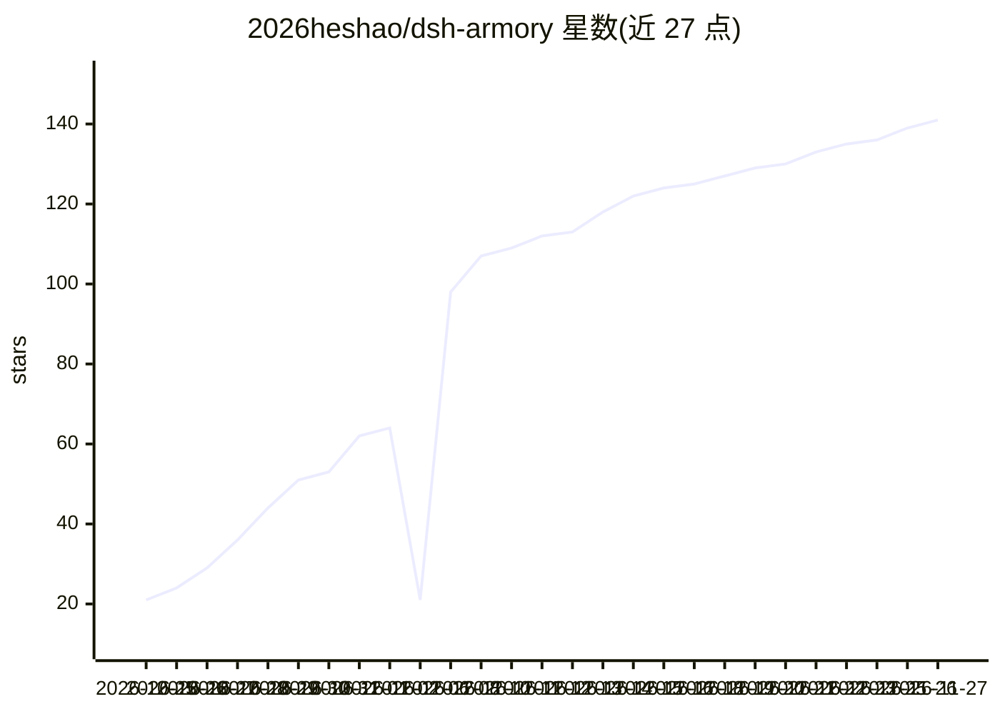

# 2026heshao/dsh-armory

⭐ 141 · JavaScript · MIT · 推送 2026-11-26 · [GitHub](https://github.com/2026heshao/dsh-armory) · [官网](https://github.com/2026heshao/dsh-armory#readme) · 个人维护 · 中文 README

**DSH 用户的 MCP/技能/专家管理看板：装过什么、连没连上一眼可见**

以 DSH 插件形式安装的一体化管理面板，聚合 MCP 连接状态管理、全局与项目级配置、11 种客户端配置导入、OAuth 授权流程，以及按 7/30/90 天统计工具调用与 token 占用的工具裁缝账本；另有 WorkBuddy 专家中心（429 位、随时挂换）、技能看板和四个市场（316 连接器、19 万+ 技能）一键安装，并用 install-state.json 记录安装来源，支持 JSON 清单导入导出。仅装 DSH 聊天、未用 MCP/技能的用户用不上。

## 筛选速览

| 维度 | 判定 | 备注 |
|---|---|---|
| AI 角色 | `ai-ecosystem` | LLM/agent 周边工具 |
| 许可风险 | `permissive` | MIT |
| 部署形态 | `desktop` | 安装包/桌面程序 |
| 模型依赖 | — | README 未给出锁定关系 |
| 硬件要求 | — | 无带数字的原话,不猜 |
| 安装摩擦 | `low` | 无编译、无系统依赖或容器化 |
| 成熟度 | — | 结构信号不足 |

## 能力要点

- MCP 全局与项目级分开管理，11 种客户端配置自动检出并一键导入
- 工具裁缝读本机会话日志统计调用与 token 占用，死工具一键禁用
- WorkBuddy 专家 429 位可随时挂载/替换到当前会话
- 四个市场直连：逐文件 sha256 校验安装，install-state.json 记录来源

## 适用场景

- DSH 装了大量 MCP 和技能后，需要统一查看状态、管理开关
- 从 Claude Code、Cursor 等客户端迁移 MCP 配置
- 分析哪些工具和技能在占用 token 并清理不用的
- 从市场查找并一键安装连接器、技能和专家

## 场景标签

 · 领域:AI 开发工具/插件面板

## 证据(README 行号)

> L6: > 军械库把 MCP、技能、专家、插件和四个市场收进一块面板：316 个连接器、19 万+ 技能、429 位专家。装过什么、连没连上、哪些工具在吃 token，打开就能看见；会话里要用什么，也能直接叫出来。
> L17: ## 装上一块面板
> L41: 从别的客户端搬过来，也不用逐条抄。Claude Code、Codex、Cursor、Windsurf、VS Code、Gemini CLI、Roo Code 等 11 种客户端的配置会被自动检出，预览后一键导入；同名冲突只跳过那一

## 星数曲线

2026-10-25 21 → 2026-11-27 141（+120）

---
*卡片 v1 · prompt 1.4 · 生成 2026-11-27 · 置信度 mid · 依据 README sha `1b002739672b` · [字段定义](../../DATASET.md)*
