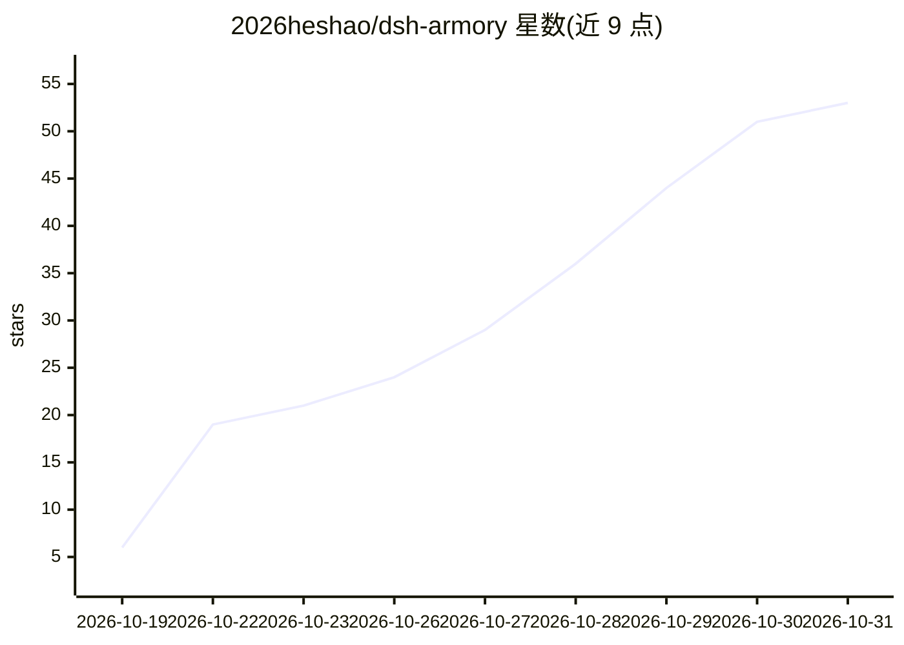

# 2026heshao/dsh-armory

⭐ 53 · JavaScript · MIT · 推送 2026-10-30 · [GitHub](https://github.com/2026heshao/dsh-armory) · [官网](https://github.com/2026heshao/dsh-armory#readme) · 个人维护 · 中文 README

**DeepSeek Harness 插件：MCP/技能/专家/市场一体化管理看板**

DeepSeek Harness（DSH）的 Web 端管理插件，fork 自 dsh-mcp-manager-ui：可视化查看与启停 MCP（全局/项目双作用域）、从 SkillHub（19 万+技能）与 WorkBuddy（316 连接器、429 专家）市场搜索并一键安装/召唤/送还专家、插件社区清单浏览与安装；另有工具裁缝扫描本机会话日志统计工具调用与上下文税、一键禁用零调用工具；支持从 Claude Code/Cursor/VS Code 等 11 种客户端导入 MCP 配置，实现 MCP OAuth 一键授权（RFC 9728/8414/7591/7636/8707）。通过 dsh plugin 命令安装，装完需重启 DSH 宿主。

## 筛选速览

| 维度 | 判定 | 备注 |
|---|---|---|
| AI 角色 | `ai-ecosystem` | LLM/agent 周边工具 |
| 许可风险 | `permissive` | MIT |
| 部署形态 | `library` | 以包/库形式分发 |
| 模型依赖 | locked-api |  |
| 硬件要求 | — | 无带数字的原话,不猜 |
| 安装摩擦 | `low` | 无编译、无系统依赖或容器化 |
| 成熟度 | — | 结构信号不足 |

## 能力要点

- MCP 全局/项目双作用域可视化管理，含工具 Schema 与 OAuth 授权
- SkillHub 19 万+技能、WorkBuddy 连接器与专家三大市场直连一键安装
- 工具裁缝扫描本机会话日志统计调用/错误/上下文税并禁用零调用工具
- 自动检出 11 种客户端的 MCP 配置并预览导入

## 适用场景

- 在可视化面板里管理 DSH 的 MCP 服务器而不是手改 YAML
- 从 SkillHub/WorkBuddy 市场搜索安装技能、连接器并召唤专家
- 分析工具上下文开销并禁用长期零调用的 MCP 工具
- 从 Claude Code/Cursor/VS Code 迁移 MCP 配置到 DSH

## 场景标签

 · 领域:AI Agent 基础设施/插件管理

## 证据(README 行号)

> L5: > **DeepSeek Harness 的一体化管理看板**：MCP · 技能 · 专家 · 插件 · 工具账本 · 四大市场，浏览、搜索、一键安装、一键召唤。
> L33: |MCP 配置要手改 YAML，改完不知道连没连上|可视化面板：状态、工具 Schema、启停、重连，全局与项目双作用域，项目级改完即对存活会话生效|
> L121: - **MCP OAuth 一键授权（2.0.0 新增）**：官方 `@deepseek-ai/dsh-mcp-client` 的 transport 只认 `requestInit.headers`、没有 authProvid

## 星数曲线

2026-10-19 6 → 2026-10-31 53（+47）

---
*卡片 v1 · prompt 1.4 · 生成 2026-10-27 · 置信度 mid · 依据 README sha `68c74ad82f50` · [字段定义](../../DATASET.md)*
