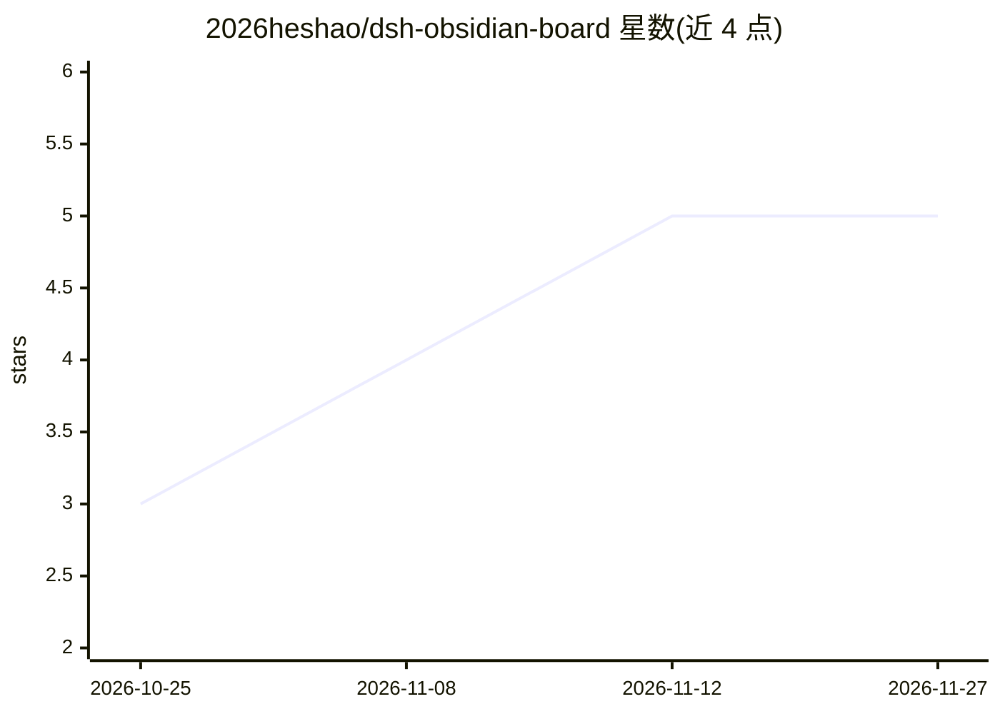

# 2026heshao/dsh-obsidian-board

⭐ 5 · JavaScript · MIT · 推送 2026-10-21 · [GitHub](https://github.com/2026heshao/dsh-obsidian-board) · [官网](https://github.com/2026heshao/dsh-obsidian-board#readme) · 个人维护 · 中文 README

**把本地 Obsidian 笔记库变成 DSH 内的本地 RAG 问答面板**

一个 DeepSeek Harness (DSH) 双半插件（宿主 + 浏览器客户端），在 DSH GUI 中注入三栏页面：左侧笔记浏览、中间检索增强对话、右侧引用原文。检索采用纯本地 BM25（CJK bigram 分词、标题/路径加权、Obsidian 标签与别名感知），不使用嵌入模型与向量库；回答生成走 DSH 已配置的模型通道，仅发送问题、最近对话与命中片段。支持增量索引、文件监听单笔记重建、cited/related 双分组引用跳转与 .md 导出。检索为词面匹配，长句改述问题可能漏召回（L84 自述）。

## 筛选速览

| 维度 | 判定 | 备注 |
|---|---|---|
| AI 角色 | `ai-native` | 本体是模型或模型工具 |
| 许可风险 | `permissive` | MIT |
| 部署形态 | `library` | 以包/库形式分发 |
| 模型依赖 | — | README 未给出锁定关系 |
| 硬件要求 | — | 无带数字的原话,不猜 |
| 安装摩擦 | `low` | 无编译、无系统依赖或容器化 |
| 成熟度 | — | 结构信号不足 |

## 能力要点

- BM25 + CJK bigram 本地检索，索引与匹配无网络调用，整库不上传
- 引用 [n] 与 chips 区分 cited 与 related snippets，点击打开右侧原文
- 文件监听只重建变更笔记（10k 笔记库单笔记端到端约 0.2–0.26 s）
- 复用宿主 ModelSelect 的模型菜单，按消息级别覆盖模型路由

## 适用场景

- 在 DSH 中直接向自己的 Obsidian 笔记提问并跳转原文
- 本地优先场景下做个人知识库问答（vault 不上传）
- 整理 long identifier 类内容（PAT、哈希、文件名）的精确检索

## 场景标签

`文档问答` `RAG` `知识库管理` · 领域:知识与检索

## 证据(README 行号)

> L5: A DeepSeek Harness (DSH) plugin that turns your local **Obsidian vault** into a **dedicated RAG chat panel** inside 
> L13: - 🔍 **Local-first retrieval** — BM25 with CJK bigram tokenization, title/path boosting, Obsidian tag & alias awaren
> L96: 把本地 **Obsidian vault** 变成 DeepSeek Harness 里的**专属知识库对话页面**（桌面端与 Web 端通用）：侧栏多一个「Obsidian」入口，点开就是一个完整面板——左侧笔记浏览器、中间 R

## 星数曲线

2026-10-25 3 → 2026-11-27 5（+2）

---
*卡片 v1 · prompt 1.4 · 生成 2026-11-21 · 置信度 mid · 依据 README sha `163560aa8756` · [字段定义](../../DATASET.md)*
