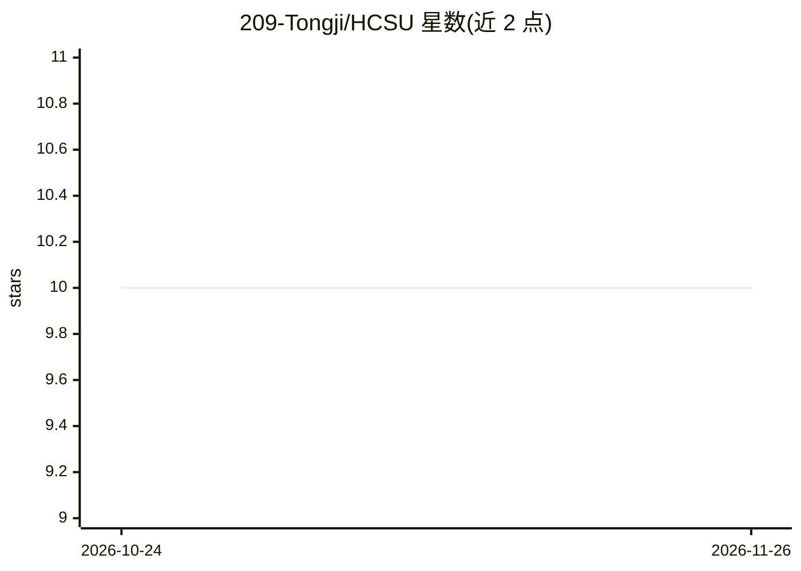

# 209-Tongji/HCSU

⭐ 10 · Python · Apache-2.0 · 推送 2026-09-24 · [GitHub](https://github.com/209-Tongji/HCSU) · [官网](https://ihanzi.net/static/HCSU) · 组织维护 · 中文 README

**面向研究者的历史中文书法细粒度风格数据集与基准**

HCSU 提供一个 10K–100K 量级的历史中文书法细粒度风格理解数据集及配套评测基准 HCSU-Bench，包含标注模式、数据处理流程、评测协议、排行榜与实现入口。数据经 Hugging Face 与 ModelScope 双渠道分发，采用 CC-BY-NC-4.0 许可；代码与数据分别授权。该工作以 ECCV 2026 论文形式发表，提供中英双语文档与 BibTeX 引用条目。

## 筛选速览

| 维度 | 判定 | 备注 |
|---|---|---|
| AI 角色 | `ai-knowledge` | 知识聚合/清单类 |
| 许可风险 | `permissive` | Apache-2.0 |
| 部署形态 | `None` |  |
| 模型依赖 | — | README 未给出锁定关系 |
| 硬件要求 | — | 无带数字的原话,不猜 |
| 安装摩擦 | `low` | 无编译、无系统依赖或容器化 |
| 成熟度 | — | 结构信号不足 |

## 能力要点

- 数据集与评测基准（HCSU-Bench）配套提供，含评测协议与排行榜
- 数据经 Hugging Face 与 ModelScope 双平台分发
- 提供中文文档（README-ch.md）与标注模式说明
- 代码与数据采用分离授权

## 适用场景

- 训练与评测书法风格细粒度识别模型
- 对比多模态模型在历史文档风格理解任务上的表现
- 构建文化遗产方向的数字人文研究数据

## 场景标签

`模型评测` `多模态` · 领域:评测与运维

## 证据(README 行号)

> L34: This repository provides the HCSU dataset documentation and HCSU-Bench evaluation code for fine-grained historical 
> L45: - Dataset: dataset overview, annotation schema, data processing pipeline, and dataset release notes.
> L46: - Benchmark: HCSU-Bench evaluation protocols, leaderboard, and implementation entry points.

## 星数曲线

2026-10-24 10 → 2026-11-26 10（+0）

---
*卡片 v1 · prompt 1.4 · 生成 2026-11-20 · 置信度 high · 依据 README sha `a8d10badf8e8` · [字段定义](../../DATASET.md)*
