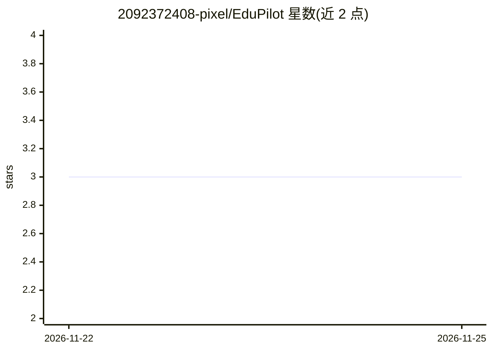

# 2092372408-pixel/EduPilot

⭐ 3 · JavaScript · NOASSERTION · 推送 2026-11-23 · [GitHub](https://github.com/2092372408-pixel/EduPilot) · [官网](https://github.com/2092372408-pixel/EduPilot/releases/latest) · 个人维护 · 中文 README

**本地优先的教材 AI 成课与复习学习工作台**

运行在用户自己电脑上的桌面学习应用：导入中英文 PDF/Word/PPT/Markdown 等教材后按章节生成课程，结合 RAG 检索做讲解与追问，配套选择题、Python 诊断练习（运行代码、查看失败输入与分级提示）、错题本、复习安排、学习报告和个人知识图谱。界面显示执行步骤、模型与工具调用、Token 用量，任务可取消与续跑。课程与学习记录保存在本机，AI 讲解需在设置中接入所选模型服务的 API Key。

## 筛选速览

| 维度 | 判定 | 备注 |
|---|---|---|
| AI 角色 | `ai-native` | 本体是模型或模型工具 |
| 许可风险 | `none` | NOASSERTION |
| 部署形态 | `desktop` | 安装包/桌面程序 |
| 模型依赖 | locked-api |  |
| 硬件要求 | — | 无带数字的原话,不猜 |
| 安装摩擦 | `low` | 无编译、无系统依赖或容器化 |
| 成熟度 | — | 结构信号不足 |

## 能力要点

- 教材导入后按章节生成课程，结合 RAG 检索讲解与追问
- Python 诊断练习：运行代码、失败输入展示、分级提示、变式新题
- 个人知识图谱连接课程、章节与知识点，支持跨课程关联
- 过程可见：执行步骤、模型与工具调用、Token 用量，可取消续跑

## 适用场景

- 把自己的教材导入成结构化课程并跟随预习、学习、复习
- 通过选择题和 Python 诊断练习检验并订正理解
- 用知识图谱整理跨课程的知识点与笔记
- 数据保存在本机、自选模型服务的本地优先学习方式

## 场景标签

`RAG` `知识图谱` · 领域:知识与检索

## 证据(README 行号)

> L11: EduPilot 是运行在自己电脑上的 AI 学习工作台。导入教材，跟随章节预习、学习与复习；通过代码练习检验理解，用个人知识图谱整理所学。课程、对话和学习记录保存在本机，AI 讲解与问答接入你选择的模型服务。
> L29: 导入中英文 PDF、Word、PowerPoint、Markdown、TXT 或 JSON，按章节组织学习内容。结合教材检索（RAG）查看讲解、追问细节、完成配套选择题，让学习围绕自己的资料展开。
> L54: 2. **接入模型**：在 **设置 → LLM 模型** 中选择供应商、填写 API Key，测试连接后保存。支持 DeepSeek、Qwen、OpenAI、GLM、Kimi 等服务及兼容接口。

## 星数曲线

2026-11-22 3 → 2026-11-25 3（+0）

---
*卡片 v1 · prompt 1.4 · 生成 2026-11-22 · 置信度 high · 依据 README sha `b97ae70437a6` · [字段定义](../../DATASET.md)*
