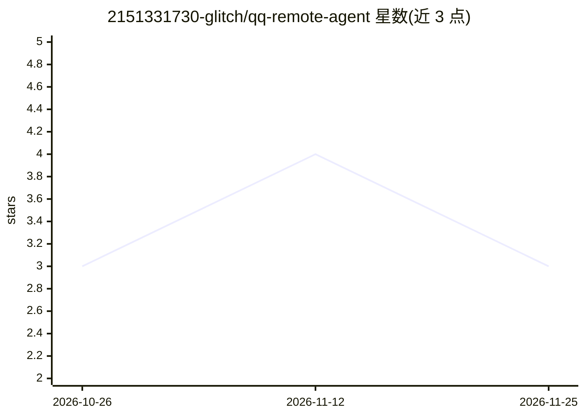

# 2151331730-glitch/qq-remote-agent

⭐ 3 · Python · MIT · 推送 2026-10-27 · [GitHub](https://github.com/2151331730-glitch/qq-remote-agent) · 个人维护 · 中文 README

**用手机 QQ 遥控 Windows 上的 Claude Code 执行任务**

通过 NapCat（OneBot11）把 QQ 消息桥接到本机 claude CLI：任务走 SQLite 持久化队列，带幂等去重、发件箱补发、按目录加锁与沙箱（Docker/WSL）后端；按通道分流——任务通道走 claude.exe，闲聊通道直连 /v1/messages 以降低固定开销；提供 Prometheus/Grafana 指标看板、本地 faster-whisper 语音转写、表情段与连发合并。限 Windows，个人自用工具，安装脚本面向单机部署。

## 筛选速览

| 维度 | 判定 | 备注 |
|---|---|---|
| AI 角色 | `ai-native` | 本体是模型或模型工具 |
| 许可风险 | `permissive` | MIT |
| 部署形态 | `desktop` | 安装包/桌面程序 |
| 模型依赖 | locked-api |  |
| 硬件要求 | — | 无带数字的原话,不猜 |
| 安装摩擦 | `low` | 无编译、无系统依赖或容器化 |
| 成熟度 | — | 结构信号不足 |

## 能力要点

- SQLite 持久化队列 + message_id 幂等去重 + 发件箱补发
- 按通道分流：闲聊直连 API，任务走 claude.exe 全工具
- Prometheus /metrics 与 Grafana 看板自动装配
- 危险命令人工确认、owner 白名单、额度限制与审计 JSONL

## 适用场景

- 出门后通过手机 QQ 让家里 Windows 机器执行命令
- 在 QQ 里和机器人闲聊并保留多轮上下文
- 给 agent 任务配指标监控与失败告警

## 场景标签

`编码 Agent` `聊天机器人` `语音识别` · 领域:编码与开发

## 证据(README 行号)

> L3: 用手机 QQ 遥控一台 Windows 机器：发一条消息，本机的 `claude` CLI 执行任务，结果分段发回 QQ。
> L50: |闲聊 / 群聊陪聊|直连 `/v1/messages`，零工具|**146~250 token**|

## 星数曲线

2026-10-26 3 → 2026-11-25 3（+0）

---
*卡片 v1 · prompt 1.4 · 生成 2026-11-21 · 置信度 mid · 依据 README sha `d595929f87c8` · [字段定义](../../DATASET.md)*
