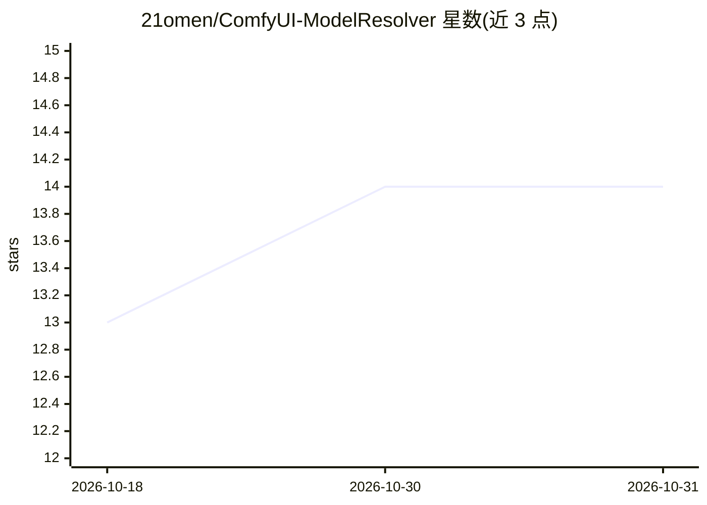

# 21omen/ComfyUI-ModelResolver

⭐ 14 · Python · MIT · 推送 2026-08-02 · [GitHub](https://github.com/21omen/ComfyUI-ModelResolver) · 个人维护

**ComfyUI 自定义节点：检测并补齐工作流缺失模型**

ComfyUI 扩展，分析活动工作流图（忽略静音/旁路/未连接节点，通用读取各节点 INPUT_TYPES，兼容自定义加载节点），找出实际缺失的模型，并从 Civitai、Hugging Face 或手动 URL 解析下载。候选要求精确文件名匹配，下载流式计算 SHA256/MD5 校验后才落盘，支持断点续传、跨源去重、识别‘已存在但被重命名’的文件。安装方式为复制文件夹到 custom_nodes 目录，无额外依赖。

## 筛选速览

| 维度 | 判定 | 备注 |
|---|---|---|
| AI 角色 | `ai-ecosystem` | LLM/agent 周边工具 |
| 许可风险 | `permissive` | MIT |
| 部署形态 | `None` |  |
| 模型依赖 | — | README 未给出锁定关系 |
| 硬件要求 | — | 无带数字的原话,不猜 |
| 安装摩擦 | `low` | 无编译、无系统依赖或容器化 |
| 成熟度 | — | 结构信号不足 |

## 能力要点

- 活动图可达性分析，忽略静音/旁路节点，通用检测自定义节点的模型引用
- Civitai / Hugging Face 多源解析，精确文件名匹配与 SHA256 去重
- 流式 SHA256/MD5 校验的可续传下载，校验失败保留 .badsha 供检查
- 手动 URL/本地文件导入与‘已存在但重命名’的哈希核验

## 适用场景

- 打开工作流后快速补齐缺失的模型文件
- 避免下载被浏览器重命名（如 (2) 后缀）而实际已有的文件
- 从任意 URL 手动导入模型并通过校验和验证完整性

## 场景标签

 · 领域:AI 工作流工具/模型管理

## 证据(README 行号)

> L3: Detects models that are **actually** missing in the active workflow graph
> L45: Copy the `ComfyUI-ModelResolver` folder into `ComfyUI/custom_nodes/` and

## 星数曲线

2026-10-18 13 → 2026-10-31 14（+1）

---
*卡片 v1 · prompt 1.4 · 生成 2026-10-31 · 置信度 high · 依据 README sha `00327bc57626` · [字段定义](../../DATASET.md)*
