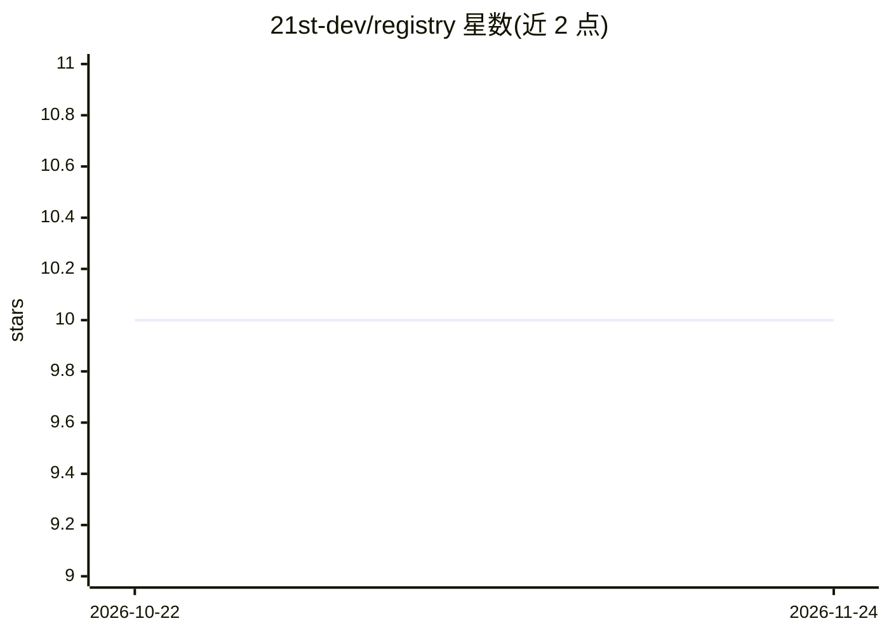

# 21st-dev/registry

⭐ 10 · TypeScript · MIT · 推送 2026-06-11 · [GitHub](https://github.com/21st-dev/registry) · [官网](https://21st.dev) · 组织维护

**管理团队私有 React 组件注册表的 CLI，支持 AI agent 操作**

面向团队的 React 组件注册表管理 CLI：支持发布任意 .tsx 组件（自动检测 demo）、安装到项目并运行包管理器、按名称/描述/标签做语义检索、生成邀请链接、多注册表组织与可见性分级。托管于 21st.dev，兼容 shadcn 格式。所有命令既可在终端运行，也可通过支持 SKILL.md 格式的 AI agent 代为执行。登录依赖 21st.dev 的 API key；删除操作需走 Web Studio。

## 筛选速览

| 维度 | 判定 | 备注 |
|---|---|---|
| AI 角色 | `ai-enhanced` | 去掉 AI 部分产品仍成立 |
| 许可风险 | `permissive` | MIT |
| 部署形态 | `library` | 以包/库形式分发 |
| 模型依赖 | — | README 未给出锁定关系 |
| 硬件要求 | — | 无带数字的原话,不猜 |
| 安装摩擦 | `low` | 无编译、无系统依赖或容器化 |
| 成熟度 | — | 结构信号不足 |

## 能力要点

- 发布/安装/语义检索/邀请等组件库管理命令
- 捆绑 SKILL.md 技能，AI agent 可代为执行命令
- 兼容 shadcn 注册表格式，发布时自动改写 demo 相对导入
- 多注册表与三级可见性（unlisted/public/private）

## 适用场景

- 团队内部沉淀和共享私有 React 组件库
- 通过对话让 Claude Code/Cursor 代为发布或安装组件
- 按名称或语义搜索团队已有组件避免重复造轮子

## 场景标签

 · 领域:前端开发工具/组件管理

## 证据(README 行号)

> L3: > **Open-source CLI for managing private React component registries.**
> L32: Every command works equally well from the terminal **or** through any AI
> L34: SKILL.md format — the bundled skill

## 星数曲线

2026-10-22 10 → 2026-11-24 10（+0）

---
*卡片 v1 · prompt 1.4 · 生成 2026-11-20 · 置信度 high · 依据 README sha `308454d5deaf` · [字段定义](../../DATASET.md)*
