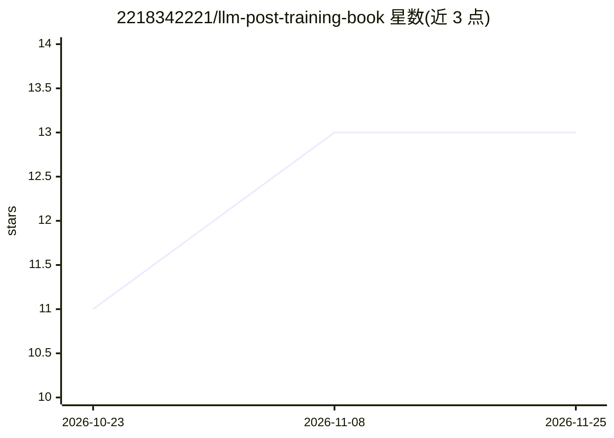

# 2218342221/llm-post-training-book

⭐ 13 · TeX · 推送 2026-08-01 · [GitHub](https://github.com/2218342221/llm-post-training-book) · [官网](https://2218342221.github.io/llm-post-training-book/) · 个人维护 · 中文 README

**面向研究生的双语 LLM 后训练教材**

以机制为主线的大语言模型后训练双语研究生教材，英文 802 页、中文 791 页，共 26 章与 4 个附录、770 条参考文献。内容覆盖 SFT、奖励模型、RLHF、DPO、RLVR、GRPO 系列推理 RL、工具调用与长程智能体训练、大规模训练系统、评测与安全对齐；提供按读者背景推荐的多条阅读路径。中英文版共享符号、公式与参考文献编号，并保持同步。源码基于 LaTeX，提供 build.sh 从源码构建 PDF，文献截止 2026 年 7 月。

## 筛选速览

| 维度 | 判定 | 备注 |
|---|---|---|
| AI 角色 | `ai-knowledge` | 知识聚合/清单类 |
| 许可风险 | `none` | — |
| 部署形态 | `None` |  |
| 模型依赖 | — | README 未给出锁定关系 |
| 硬件要求 | — | 无带数字的原话,不猜 |
| 安装摩擦 | `low` | 无编译、无系统依赖或容器化 |
| 成熟度 | — | 结构信号不足 |

## 能力要点

- 26 章 + 4 附录、770 条参考文献的双语教材，中英文结构同步
- 覆盖从 SFT/RLHF/DPO 到 RLVR、GRPO、智能体训练与安全的完整后训练链条
- 提供按背景定制的阅读路径（入门/推理 RL/智能体/实现细节）
- build.sh 一键构建英文与中文 PDF（pdflatex/xelatex）

## 适用场景

- 作为研究生课程教材系统学习 LLM 后训练
- 自学并了解推理 RL 与智能体训练的机制原理
- 查阅 DPO、GRPO 等方法的推导、伪代码与工程陷阱

## 场景标签

`教程课程` · 领域:学习与行业

## 证据(README 行号)

> L9:  A mechanism-first graduate textbook on modern LLM post-training.
> L11:  一本系统讲解大语言模型后训练的双语研究生教材。
> L63: |Main chapters|26|

## 星数曲线

2026-10-23 11 → 2026-11-25 13（+2）

---
*卡片 v1 · prompt 1.4 · 生成 2026-11-18 · 置信度 high · 依据 README sha `74d3f4ab1de4` · [字段定义](../../DATASET.md)*
