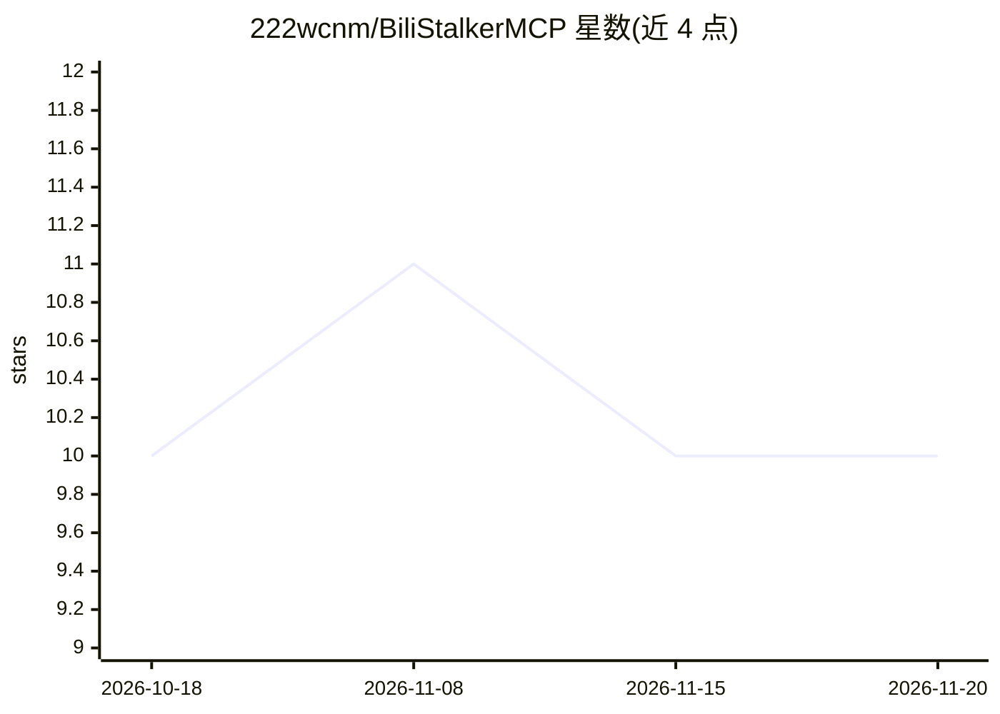

# 222wcnm/BiliStalkerMCP

⭐ 10 · Python · MIT · 推送 2026-11-19 · [GitHub](https://github.com/222wcnm/BiliStalkerMCP) · 个人维护 · 中文 README

**面向 AI agent 的 Bilibili 用户数据 MCP 服务器与 CLI 工具**

基于 Model Context Protocol 构建的 Bilibili MCP 服务器与命令行工具：以目标用户 uid 或用户名为起点，通过 12 个结构化工具读取其主页资料、视频、动态、专栏文章、字幕与关注列表。提供 PyPI 发行版、源码克隆两种运行方式，支持 stdio MCP 服务器与不依赖 MCP 客户端的独立 CLI 查询；通过 SESSDATA 或 Cookie 文件鉴权，内置代理路由、请求抖动、超时预算、Cookie 可选自动刷新与 doctor 诊断等运行控制。

## 筛选速览

| 维度 | 判定 | 备注 |
|---|---|---|
| AI 角色 | `ai-ecosystem` | LLM/agent 周边工具 |
| 许可风险 | `permissive` | MIT |
| 部署形态 | `self-host` | docker 或自建部署 |
| 模型依赖 | — | README 未给出锁定关系 |
| 硬件要求 | — | 无带数字的原话,不猜 |
| 安装摩擦 | `low` | 无编译、无系统依赖或容器化 |
| 成熟度 | — | 结构信号不足 |

## 能力要点

- 12 个工具覆盖 Bilibili 用户资料、视频、动态、文章、字幕与关注
- MCP 服务器与独立 CLI 双模式，CLI 支持退出码、JSON stdin/args-file 与 doctor 诊断
- 代理路由、请求抖动与 25 秒工具超时预算等风控与稳定性配置
- Cookie 可选自动刷新（默认关闭）与凭据文件分离的刷新令牌机制

## 适用场景

- 让 Claude Code 等 agent 通过 MCP 工具查询指定 Bilibili 用户的资料与动态
- 在终端直接用 CLI 跟踪某创作者的视频与专栏更新
- 对 Bilibili 用户内容做结构化抓取并输出 JSON 结果

## 场景标签

`网页抓取` · 领域:效率与自动化

## 证据(README 行号)

> L10: BiliStalkerMCP is a Bilibili MCP server and command-line tool built on Model Context Protocol (MCP), designed for A
> L12: It is optimized for workflows that start from a target uid or username, then retrieve that user's profile, videos, 
> L14: If you are searching for a Bilibili MCP server, a Bilibili Model Context Protocol server, or an MCP server for trac

## 星数曲线

2026-10-18 10 → 2026-11-20 10（+0）

---
*卡片 v1 · prompt 1.4 · 生成 2026-11-20 · 置信度 mid · 依据 README sha `ef1a06edcd1b` · [字段定义](../../DATASET.md)*
