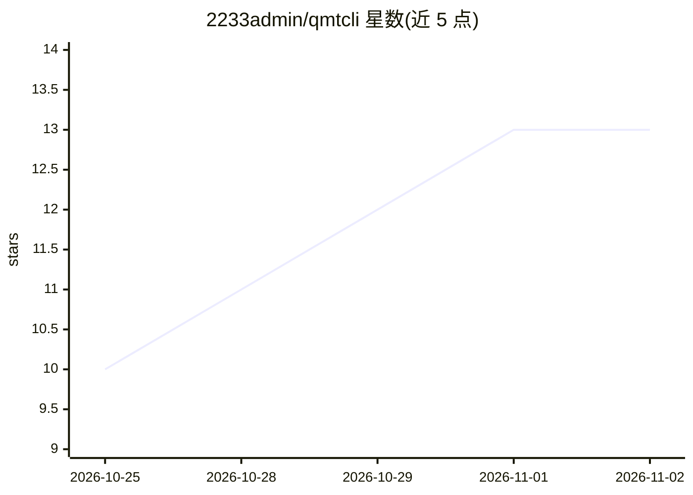

# 2233admin/qmtcli

⭐ 13 · Python · MIT · 推送 2026-10-30 · [GitHub](https://github.com/2233admin/qmtcli) · 个人维护 · 中文 README

**把 QMT/xtquant 包装成只读本地 JSON CLI，供脚本与 AI Agent 调用**

为迅投 QMT/XtQuant SDK 提供一层 stdin/stdout JSON 接口：本机起子进程连已登录的 QMT 客户端，60+ 条子命令覆盖行情查询、交易日历、板块管理、账户与交易查询、数据下载，DataFrame/NaN 转成合法 JSON。支持 rpc 单请求、server JSONL 循环、watch 流式推送及 stdio MCP 服务，任何语言或 LLM Agent 无需 Python SDK 即可调用。安全边界：不下单、不撤单、不划资金、不保存凭据。需本机已安装并登录 QMT；对照官方文档核对 68 个接口并有每周 doc-drift CI。

## 筛选速览

| 维度 | 判定 | 备注 |
|---|---|---|
| AI 角色 | `ai-ecosystem` | LLM/agent 周边工具 |
| 许可风险 | `permissive` | MIT |
| 部署形态 | `library` | 以包/库形式分发 |
| 模型依赖 | — | README 未给出锁定关系 |
| 硬件要求 | — | 无带数字的原话,不猜 |
| 安装摩擦 | `low` | 无编译、无系统依赖或容器化 |
| 成熟度 | `idea` | |

## 能力要点

- 60+ CLI 子命令，对照官方文档核对 43 个 xtdata 函数与 25 组 xttrader 接口，267 个测试全绿
- 只读边界：不下单/不撤单/不划资金，trade-call 仅放行查询方法
- 提供 rpc/server JSONL/watch 流式推送与 stdio MCP 服务，工具从能力清单自动生成
- pandas 感知的 JSON 输出，NaN/NaT 转为合法 JSON 值

## 适用场景

- 让 LLM Agent 直接查 A 股行情与持仓（如注册进 Claude Code）
- 用 Rust/Go/Node.js 写量化系统而无需起 Python 服务
- 在无 QMT 环境的 CI 里跑基于 fake xtquant 的测试

## 场景标签

`金融量化` · 领域:学习与行业

## 证据(README 行号)

> L9: 给 QMT / XtQuant 装一层稳定的接口，让任何语言、任何 Agent 都能安全稳定的调用它。
> L41: - 想让 LLM Agent（Claude、GPT、本地模型）直接查行情、看持仓的人——`qmtcli ` 一条
> L241: `qmtcli mcp` 会启动一个 stdio MCP（Model Context Protocol）服务，把 qmtcli 命令暴露成 MCP

## 星数曲线

2026-10-25 10 → 2026-11-02 13（+3）

---
*卡片 v1 · prompt 1.4 · 生成 2026-10-31 · 置信度 mid · 依据 README sha `c1d13c4cfb1b` · [字段定义](../../DATASET.md)*
