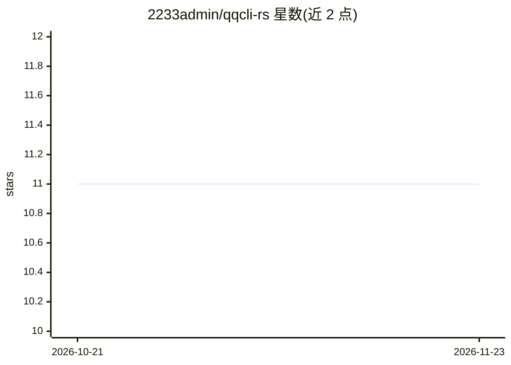

# 2233admin/qqcli-rs

⭐ 11 · Rust · MIT · 推送 2026-10-22 · [GitHub](https://github.com/2233admin/qqcli-rs) · 个人维护 · 中文 README

**为用户与 AI Agent 提供 QQ NT 聊天记录本地搜索、导出与备份的 CLI**

面向 Windows 的 Rust 命令行工具，读取本机 QQ NT 数据目录，构建全文索引，支持会话查看、关键词搜索，以及经用户明确同意后将指定会话导出为 Markdown/JSONL。安全模型将读取、解密、外发三类操作分离，解密与外发各需一次性显式同意；提供 JSON 输出、稳定退出码与 next_command 恢复机制的 Agent 集成契约。仅支持 Windows 与 QQ NT 本地数据，QQ 须在本机至少运行过一次，暂不支持 Linux/macOS。

## 筛选速览

| 维度 | 判定 | 备注 |
|---|---|---|
| AI 角色 | `ai-enhanced` | 去掉 AI 部分产品仍成立 |
| 许可风险 | `permissive` | MIT |
| 部署形态 | `None` |  |
| 模型依赖 | — | README 未给出锁定关系 |
| 硬件要求 | — | 无带数字的原话,不猜 |
| 安装摩擦 | `low` | 无编译、无系统依赖或容器化 |
| 成熟度 | — | 结构信号不足 |

## 能力要点

- 本地全文索引与关键词搜索，无需打开 QQ 客户端
- JSON 输出、退出码 0/2/3 与 next_command 的 Agent 自动化契约
- 读取/解密/外发三段式同意模型，密钥经 Windows DPAPI 保护
- 导出格式为 Markdown 与 JSONL，可选 NapCat 集成发送消息

## 适用场景

- 在 PowerShell 或 AI Agent 中快速检索本地 QQ 历史消息
- 对用户选定的会话做经同意的导出备份或分析
- 排查 QQ 数据库缺失或加密导致的接入问题

## 场景标签

 · 领域:即时通讯数据管理工具

## 证据(README 行号)

> L30: `qqcli` is a local Windows command-line tool for **QQ chat history search, QQ NT database access, chat export, and 
> L47: |Agent-ready contract|JSON output, stable exit codes, redacted diagnostics, and a `next_command` for recovery.|
> L89: The Agent contract is designed so an Agent can explain what is needed, pause for authorization, and recover from a 

## 星数曲线

2026-10-21 11 → 2026-11-23 11（+0）

---
*卡片 v1 · prompt 1.4 · 生成 2026-11-19 · 置信度 mid · 依据 README sha `3e34d9395445` · [字段定义](../../DATASET.md)*
