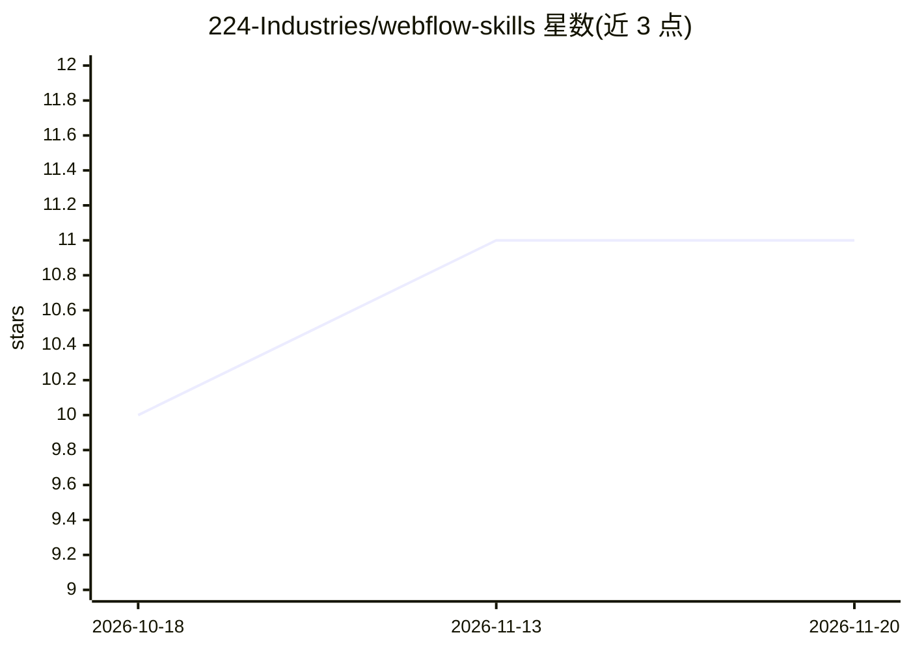

# 224-Industries/webflow-skills

⭐ 11 · Python · MIT · 推送 2026-10-19 · [GitHub](https://github.com/224-Industries/webflow-skills) · [官网](https://224industries.com.au/webflow-skills) · 组织维护

**给 AI agent 使用的 Webflow 站点操作技能集**

224 Industries 维护的开源 Webflow Agent Skills 集合，以 SKILL 格式为 Claude 等 AI agent 提供 Webflow 相关的领域知识，覆盖 8 个技能：Browser API 控制 Analyze/Optimize、React 代码组件导入、Designer API、Enterprise API、站点表现问答、llms.txt 生成与审计、JSON-LD 结构化数据构建审计、Webhook 接收验证。通过 npx 安装、上传 .skill 文件至 Claude Customize>Skills，或在 Claude Code 中以插件形式添加。MIT 许可。

## 筛选速览

| 维度 | 判定 | 备注 |
|---|---|---|
| AI 角色 | `ai-knowledge` | 知识聚合/清单类 |
| 许可风险 | `permissive` | MIT |
| 部署形态 | `library` | 以包/库形式分发 |
| 模型依赖 | — | README 未给出锁定关系 |
| 硬件要求 | — | 无带数字的原话,不猜 |
| 安装摩擦 | `low` | 无编译、无系统依赖或容器化 |
| 成熟度 | — | 结构信号不足 |

## 能力要点

- 8 个 Webflow 主题技能，含 llms.txt 与 JSON-LD 审计工具
- 支持 npx skills add、.skill 文件上传、Claude Code 插件三种安装方式
- 面向 Designer API / Enterprise API / DevLink 等官方接口

## 适用场景

- 让 AI agent 为 Webflow 站点生成和维护 llms.txt
- 通过对话构建和修复 Webflow 站点的结构化数据
- 在 Claude Code 中管理 Webflow Designer 扩展开发流程

## 场景标签

 · 领域:AI agent 技能/网站开发工具

## 证据(README 行号)

> L3: Open-source Agent Skills for Webflow, by 224 Industries. They give Claude and other AI agents the know-how to work o
> L7: ## Available skills

## 星数曲线

2026-10-18 10 → 2026-11-20 11（+1）

---
*卡片 v1 · prompt 1.4 · 生成 2026-11-19 · 置信度 high · 依据 README sha `a2da646aeec6` · [字段定义](../../DATASET.md)*
