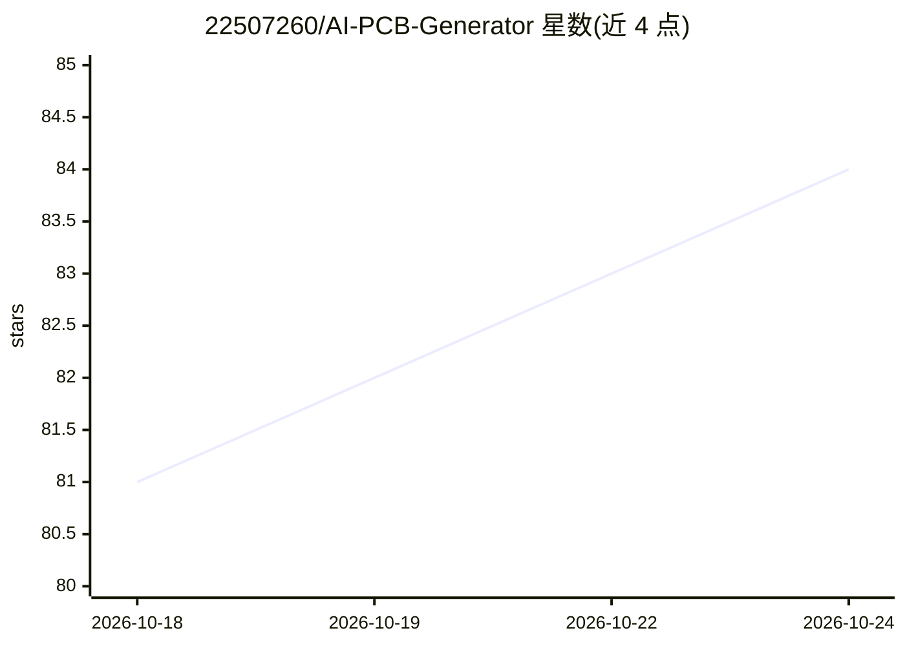

# 22507260/AI-PCB-Generator

⭐ 84 · Python · MIT · 推送 2026-10-03 · [GitHub](https://github.com/22507260/AI-PCB-Generator) · 个人维护

**从自然语言描述生成 PCB 设计的桌面套件**

基于 Python/Qt 的开源 PCB 设计应用：用户用英文或土耳其语描述电路，调用 LLM（OpenAI GPT-4o、Gemini、Claude 或 OpenAI 兼容 API）生成原理图规格，随后自动布局、布线（Freerouting 或内置 A* 路由）、SPICE 仿真（内置 NgSpice 46）、12 项 DFM 检查，并导出 Gerber/BOM/CPL/KiCad 文件，支持 JLCPCB 等厂商一键下单。含拖放式原理图编辑器与 OpenGL 3D 查看器。需 Python 3.10+ 与 AI API key，从源码运行，KiCad 9.0 推荐但可选。

## 筛选速览

| 维度 | 判定 | 备注 |
|---|---|---|
| AI 角色 | `ai-native` | 本体是模型或模型工具 |
| 许可风险 | `permissive` | MIT |
| 部署形态 | `library` | 以包/库形式分发 |
| 模型依赖 | locked-api |  |
| 硬件要求 | — | 无带数字的原话,不猜 |
| 安装摩擦 | `low` | 无编译、无系统依赖或容器化 |
| 成熟度 | — | 结构信号不足 |

## 能力要点

- 自然语言生成完整原理图与 PCB 布局，支持 OpenAI/Gemini/Claude 及 OpenAI 兼容 API
- 内置 NgSpice 46 仿真（DC/瞬态/AC/DC 扫描）与无外部依赖的 MNA 求解器
- 12 项基于 IPC-2221 的 DFM 检查与 0-100 可制造性评分
- 导出 Gerber/BOM/CPL/KiCad 文件，附 JLCPCB/PCBWay/OSH Park 厂商能力校验

## 适用场景

- 用一句话描述需求快速得到可制造的 PCB 设计
- 在打样前跑 SPICE 仿真和 DFM 分析
- 生成 Gerber/BOM/CPL 包并直接向 JLCPCB 下单

## 场景标签

`代码生成` · 领域:编码与开发

## 证据(README 行号)

> L8:  Describe your circuit in plain English or Turkish → AI generates the full schematic → auto-places components → rout
> L32: Type a description in **natural language** and the AI generates a complete circuit specification — components, pin 
> L220: 1. **Describe** — Type your circuit in the left panel:

## 星数曲线

2026-10-18 81 → 2026-10-24 84（+3）

---
*卡片 v1 · prompt 1.4 · 生成 2026-10-24 · 置信度 mid · 依据 README sha `086485ac127a` · [字段定义](../../DATASET.md)*
