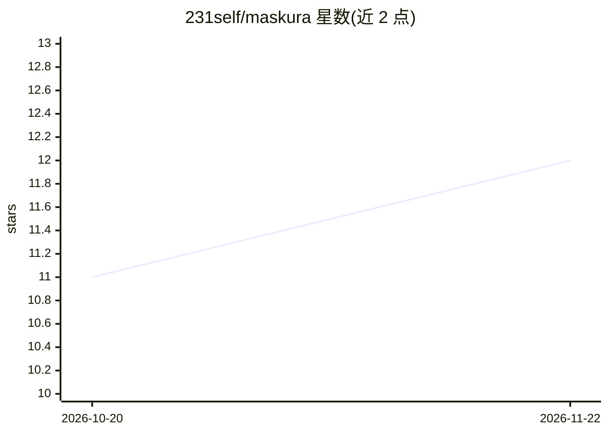

# 231self/maskura

⭐ 12 · Rust · Apache-2.0 · 推送 2026-11-16 · [GitHub](https://github.com/231self/maskura) · [官网](https://maskura.dev) · 组织维护

**为 AI 代理提供对象存储数据隐私网关：过滤、脱敏与加密**

Maskura 定位为 AI 代理与对象存储之间的策略边界：以有序 Wasm 组件流水线对对象数据执行校验、拒绝、重整、脱敏或加密，支持确定性 AES-SIV 加密（可连接/去重）、X25519+ML-KEM-768 混合封装且私钥保留在客户端、内容寻址的不可变流水线版本与沙箱运行时。以 S3 兼容的 Docker 服务本地运行，或置于既有存储之前；通过 AWS 兼容工具、CLI、Python/TypeScript 客户端及本地 MCP 服务器访问同一条数据路径。PII 脱敏与加密均为显式启用，默认原样存储字节。

## 筛选速览

| 维度 | 判定 | 备注 |
|---|---|---|
| AI 角色 | `ai-ecosystem` | LLM/agent 周边工具 |
| 许可风险 | `permissive` | Apache-2.0 |
| 部署形态 | `self-host` | docker 或自建部署 |
| 模型依赖 | — | README 未给出锁定关系 |
| 硬件要求 | — | 无带数字的原话,不猜 |
| 安装摩擦 | `low` | 无编译、无系统依赖或容器化 |
| 成熟度 | — | 结构信号不足 |

## 能力要点

- Wasm 组件流水线可验证、拒绝、重整、脱敏或加密对象数据
- 客户端持有解密私钥，网关只接收公钥
- 内容寻址策略：请求绑定到不可变流水线版本与组件摘要
- 发布物附 SBOM、校验和与来源证明

## 适用场景

- 为 AI 代理读写 S3 数据的路径上插入 PII 脱敏与加密策略
- 在本地以 S3 兼容端点托管带隐私策略的对象存储
- 为自定义数据过滤逻辑编写并加载 Wasm 插件

## 场景标签

 · 领域:AI 基础设施/数据安全

## 证据(README 行号)

> L10: Maskura is the open-source policy boundary between AI agents and object storage.
> L15: encrypt object data. Maskura runs locally as an S3-compatible Docker service or
> L46: and TypeScript clients, and the local MCP server.

## 星数曲线

2026-10-20 11 → 2026-11-22 12（+1）

---
*卡片 v1 · prompt 1.4 · 生成 2026-11-19 · 置信度 high · 依据 README sha `0f6fb61463b3` · [字段定义](../../DATASET.md)*
