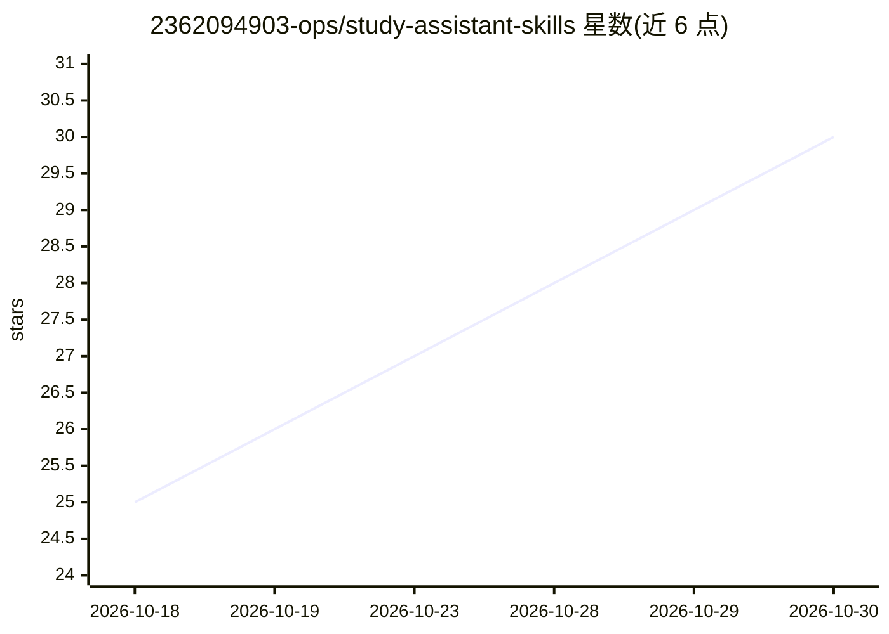

# 2362094903-ops/study-assistant-skills

⭐ 30 · Python · MIT · 推送 2026-08-08 · [GitHub](https://github.com/2362094903-ops/study-assistant-skills) · 个人维护 · 中文 README

**面向备考用户的 Claude Code 学习辅导 Skill 套件**

一套运行于 Claude Code 的学习辅导技能包（6 个 Skill：主控编排、思维导图、讲义生成、出题测验、费曼检验、识图），用户上传教材/课件后按知识点逐个生成讲义、合并审查整章 HTML、按真题风格出交互试卷、维护错题本与掌握度仪表盘，学习进度以本地文件跨会话保存。产物由模型写结构化 JSON、脚本渲染以保证不同模型输出一致。识图在模型无视觉能力时可调用用户自配的 OpenAI 兼容或 Anthropic API。适用于考研、期末、资格证书备考。

## 筛选速览

| 维度 | 判定 | 备注 |
|---|---|---|
| AI 角色 | `ai-native` | 本体是模型或模型工具 |
| 许可风险 | `permissive` | MIT |
| 部署形态 | `library` | 以包/库形式分发 |
| 模型依赖 | — | README 未给出锁定关系 |
| 硬件要求 | — | 无带数字的原话,不猜 |
| 安装摩擦 | `low` | 无编译、无系统依赖或容器化 |
| 成熟度 | — | 结构信号不足 |

## 能力要点

- 6 个 Skill 分工：主控编排/导图/讲义/测验/费曼检验/识图
- 学习进度跨会话保存于教材旁本地文件夹
- 产物由模型写 JSON、固定脚本渲染，不同模型输出结构一致
- 无视觉能力模型可调用用户自配 OpenAI 兼容/Anthropic 识图 API

## 适用场景

- 上传考研教材按章节系统学习并生成讲义
- 按目标院校真题风格出交互试卷并批改
- 用费曼检验和错题本复盘薄弱知识点
- 跨会话续学，随时恢复上次学习进度

## 场景标签

 · 领域:教育/学习辅导

## 证据(README 行号)

> L7: 一套用于 Claude Code 的系统化学习 Skill 套件。**考研、期末考试、资格证书备考都适用**——上传教材、课件、讲义或任何学习资料，它会像一位严格但耐心的辅导老师一样带你**按章节吃透**：
> L9: > 画思维导图 → 每次生成一个知识点讲义 → 自动合并并审查整章主讲义 → 按目标院校真题风格出题 → 交互试卷即时判分 → 错题本换壳复盘 → 费曼检验验收 → 仪表盘追踪掌握度。**学习进度跨会话保存**，随时"继续学习"接着
> L30:     U[用户] --> A[study-assistant 主控编排 + 学习档案]

## 星数曲线

2026-10-18 25 → 2026-10-30 30（+5）

---
*卡片 v1 · prompt 1.4 · 生成 2026-10-26 · 置信度 mid · 依据 README sha `c7120d711617` · [字段定义](../../DATASET.md)*
