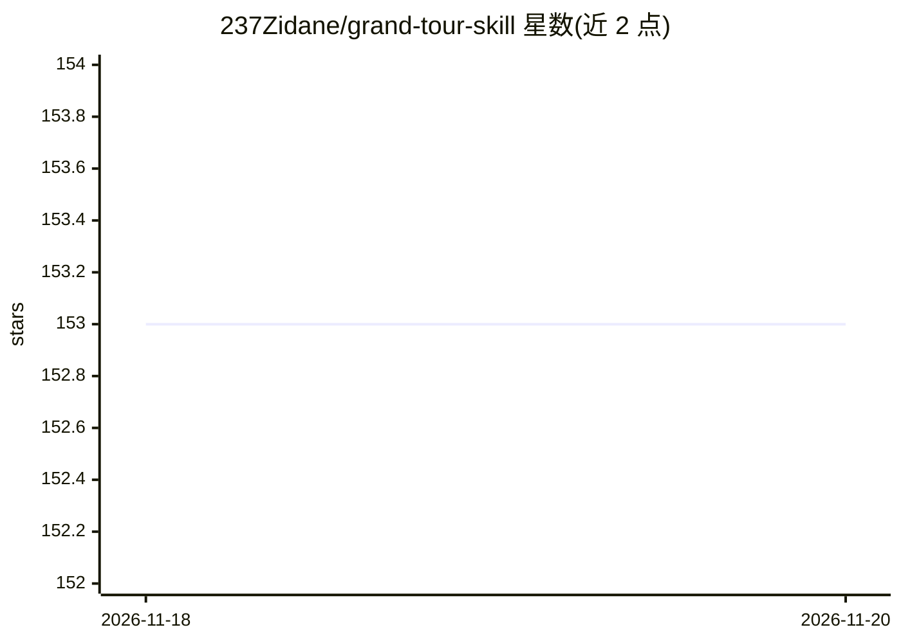

# 237Zidane/grand-tour-skill

⭐ 153 · HTML · MIT · 推送 2026-11-19 · [GitHub](https://github.com/237Zidane/grand-tour-skill) · 个人维护

**代码库导览技能：让 agent 阅读仓库并测验你的理解**

以 SKILL.md 形式提供的 agent 技能，通过 /grand-tour 调用：读取整个仓库（源码树、模块边界、git 历史），选取一个与仓库结构匹配的隐喻，用玩具数据追踪一条真实执行路径，命名设计模式，并输出安全与缺陷发现。提供三种模式：live（导览页+六轮聊天测验）、print（14–18 页手册与练习册，需 headless Chromium 与 Poppler）、grade（读取练习册照片手写内容并评分）。面向需要理解或交接代码库的开发者。要求 PowerShell 5.1+ 与 Windows 10/11，仅需 SKILL.md 即可加载，缺失资源按需拉取。

## 筛选速览

| 维度 | 判定 | 备注 |
|---|---|---|
| AI 角色 | `ai-native` | 本体是模型或模型工具 |
| 许可风险 | `permissive` | MIT |
| 部署形态 | `None` |  |
| 模型依赖 | — | README 未给出锁定关系 |
| 硬件要求 | — | 无带数字的原话,不猜 |
| 安装摩擦 | `low` | 无编译、无系统依赖或容器化 |
| 成熟度 | — | 结构信号不足 |

## 能力要点

- 全仓库解析后生成叙述，每条论断可溯源到文件、符号或提交
- live/print/grade 三种输出模式，含六轮问答测验与三轴评分（accurate/fitted/confident）
- 通过 git 历史自动判断读者是构建者还是接手者并调整表述
- 安全发现与确认的缺陷不会被为篇幅而删减

## 适用场景

- 接手他人代码库时快速建立系统级理解
- 准备面试或设计讨论时为代码中的模式建立词汇
- 以练习册形式训练并向他人证明自己能解释系统

## 场景标签

`代码审查` · 领域:编码与开发

## 证据(README 行号)

> L7: Grand Tour Skill is a comprehension skill that conducts an and over a repository. It reads the full project, traces 
> L28: - **Three output modes:** `live` (default) emits a guided-tour page then runs a six-round chat scavenger hunt. `pri

## 星数曲线

2026-11-18 153 → 2026-11-20 153（+0）

---
*卡片 v1 · prompt 1.4 · 生成 2026-11-18 · 置信度 high · 依据 README sha `8592db01baf1` · [字段定义](../../DATASET.md)*
