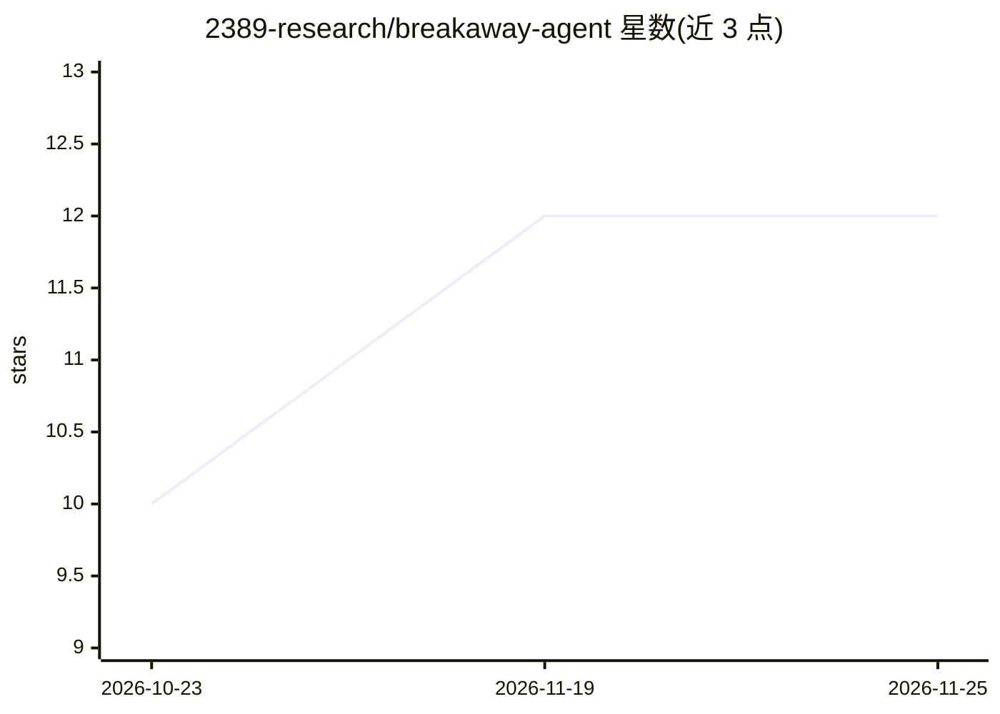

# 2389-research/breakaway-agent

⭐ 12 · TypeScript · 推送 2026-09-19 · [GitHub](https://github.com/2389-research/breakaway-agent) · 个人维护

**极简可魔改的编码 agent 实验平台，核心循环一处可读**

以 TypeScript + Bun 实现的微型编码 agent：核心 run() 循环约 165 行且与策略解耦，策略、上下文策略、工具集与 system prompt 均可替换。内置 5 个工具（读写文件、精确编辑、bash、子 agent），支持一次执行与 REPL 两种模式，JSONL 记录每次运行。无权限提示与沙箱，直接执行模型请求的任意 shell 命令，README 明确建议在一次性 VM 或临时目录运行。支持热重载自身源码、子 agent 嵌套（默认深度上限 3）与编译为独立二进制。

## 筛选速览

| 维度 | 判定 | 备注 |
|---|---|---|
| AI 角色 | `ai-native` | 本体是模型或模型工具 |
| 许可风险 | `none` | — |
| 部署形态 | `None` |  |
| 模型依赖 | — | README 未给出锁定关系 |
| 硬件要求 | — | 无带数字的原话,不猜 |
| 安装摩擦 | `low` | 无编译、无系统依赖或容器化 |
| 成熟度 | `idea` | |

## 能力要点

- 策略盲核心循环（~165 行），策略/上下文/工具/system prompt 可替换
- spawn_agent 子 agent 嵌套，agents.jsonl 注册表与实时状态轮询
- 自修改支持：SIGHUP 热重载、SIGUSR2 退出码 42 自动重启
- bun build --compile 产出 ~61MB 独立二进制

## 适用场景

- 实验和对比不同的 agent 循环设计与上下文策略
- 在可丢弃环境中让 agent 自动执行小型编码任务
- 阅读一个完整编码 agent 的最小实现来学习 agent loop

## 场景标签

`编码 Agent` · 领域:编码与开发

## 证据(README 行号)

> L3: A deliberately tiny, hackable code agent. An experiment platform for exploring agent loop design — swappable policy,
> L7: break-away has no permission prompts, no sandboxing, and no confirmation dialogs. It executes arbitrary shell comman
> L46: The model drives five tools:

## 星数曲线

2026-10-23 10 → 2026-11-25 12（+2）

---
*卡片 v1 · prompt 1.4 · 生成 2026-11-19 · 置信度 high · 依据 README sha `ea5af1fb2945` · [字段定义](../../DATASET.md)*
