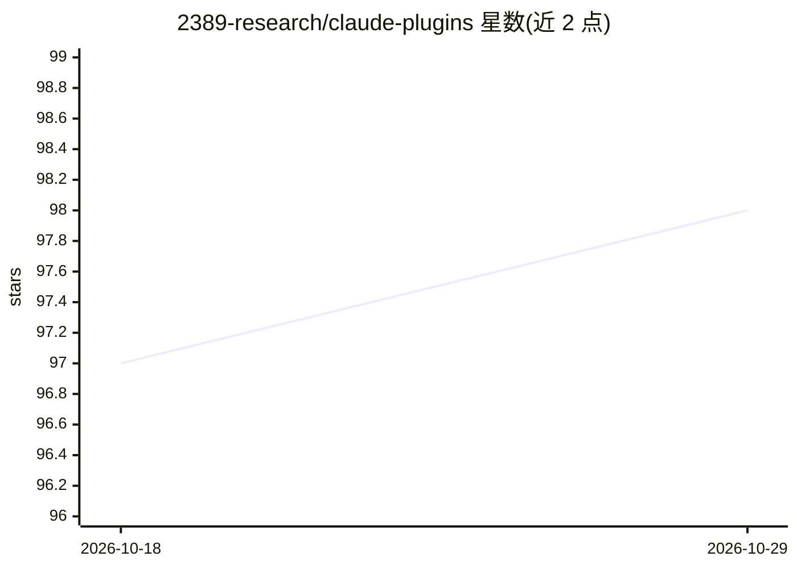

# 2389-research/claude-plugins

⭐ 98 · JavaScript · MIT · 推送 2026-10-28 · [GitHub](https://github.com/2389-research/claude-plugins) · [官网](https://2389.ai/research/products/skills-marketplace/) · 组织维护

**面向 Claude Code 的 28 个插件与 MCP 服务器集合**

由 2389 团队维护的 Claude Code 插件市场，收录 28 个插件与 MCP 服务器，覆盖 TDD/并行探索、迭代产物精炼、二进制逆向、多 agent 架构、测试审查、会议摘要与 Slack 集成等开发与业务场景。安装方式有两条路径：任意 agent（Claude Code、Cursor、Codex 等）可用 npx skills add 安装技能型插件，MCP 服务器（journal、socialmedia、slack-mcp、agent-drugs）仅限 Claude Code 原生安装。贡献流程依赖 marketplace.json 与 npm run generate。MIT 许可。

## 筛选速览

| 维度 | 判定 | 备注 |
|---|---|---|
| AI 角色 | `ai-ecosystem` | LLM/agent 周边工具 |
| 许可风险 | `permissive` | MIT |
| 部署形态 | `library` | 以包/库形式分发 |
| 模型依赖 | — | README 未给出锁定关系 |
| 硬件要求 | — | 无带数字的原话,不猜 |
| 安装摩擦 | `low` | 无编译、无系统依赖或容器化 |
| 成熟度 | — | 结构信号不足 |

## 能力要点

- 28 个插件与 4 个 MCP 服务器，按元插件/开发/测试/业务/工具分类
- npx skills add 一条命令安装技能到任意 agent（含 Cursor、Codex）
- MCP 服务器仅限 Claude Code 原生 /plugin 安装

## 适用场景

- 给 Claude Code 增加测试、审查、逆向等专项技能
- 跨 agent 环境复用同一套技能插件
- 查找 Slack 集成、会议摘要等 MCP 服务器

## 场景标签

 · 领域:AI 开发者工具/插件生态

## 证据(README 行号)

> L3: 28 plugins and MCP servers for Claude Code — parallel exploration, iterative refinement, binary reverse engineering,
> L25: > The 4 MCP servers (journal, socialmedia, slack-mcp, agent-drugs) install via Claude Code only — they ship no skil

## 星数曲线

2026-10-18 97 → 2026-10-29 98（+1）

---
*卡片 v1 · prompt 1.4 · 生成 2026-10-23 · 置信度 high · 依据 README sha `eb9e4395178c` · [字段定义](../../DATASET.md)*
