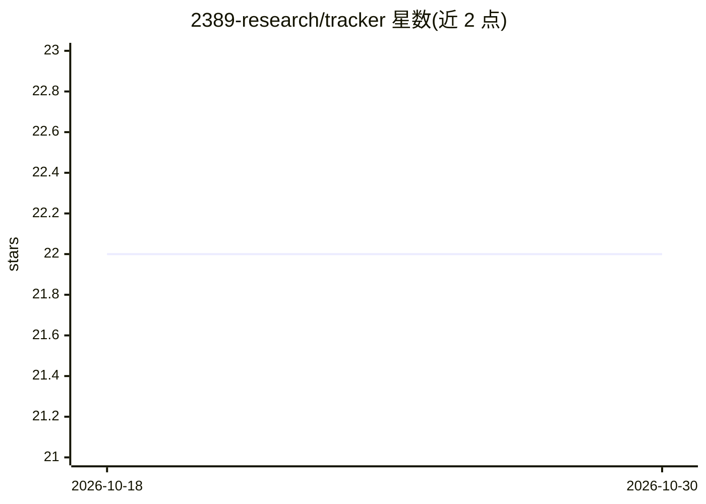

# 2389-research/tracker

⭐ 22 · Go · MIT · 推送 2026-10-27 · [GitHub](https://github.com/2389-research/tracker) · [官网](https://2389.ai/research/products/tracker/) · 组织维护

**多智能体 LLM 工作流的管道编排引擎，含 TUI 仪表盘**

用 Go 编写的管道编排引擎：以 .dip 文件（Dippin DSL）定义多智能体 LLM 工作流，并行执行并配合 TUI 仪表盘展示进度。内嵌 explain/quickfix/ask_and_execute/build_product 等六个流水线，在隔离 git worktree 中运行代理，提供人工审批门、合同测试核对、环境引导钩子与操作员豁免戳等质量门机制。后端可复用已登录的 Claude Code 订阅或 API key，面向希望在终端/CI/Slack 中编排代理工作流的开发者。

## 筛选速览

| 维度 | 判定 | 备注 |
|---|---|---|
| AI 角色 | `ai-ecosystem` | LLM/agent 周边工具 |
| 许可风险 | `permissive` | MIT |
| 部署形态 | `self-host` | docker 或自建部署 |
| 模型依赖 | locked-api |  |
| 硬件要求 | — | 无带数字的原话,不猜 |
| 安装摩擦 | `low` | 无编译、无系统依赖或容器化 |
| 成熟度 | — | 结构信号不足 |

## 能力要点

- Dippin DSL（.dip 文件）定义多智能体并行流水线
- 代理在隔离 git worktree 与独立分支上工作，主检出不被修改
- 合同测试核对：声明未执行的测试判红（CONTRACT-TEST-MISSING）
- 内嵌六个流水线，支持 LLM judge 自动审批与 CI 中断恢复

## 适用场景

- 让代理在隔离分支上做小修改并人工审批提交
- 按 SPEC.md 分里程碑自动实现产品并通过测试门验证
- 多代理并行实现同一需求并交叉评审择优

## 场景标签

`多智能体` `Agent 框架` · 领域:Agent 开发

## 证据(README 行号)

> L3: Pipeline orchestration engine for multi-agent LLM workflows. Define pipelines in `.dip` files (Dippin, our pipeline 
> L42: - **Bring a spec** — `tracker init build_product` scaffolds `build_product.dip` + a starter `SPEC.md`; edit the spe
> L61: Competitive implementation: ask the user what to build, fan out to 3 agents (Claude/Codex/Gemini) in isolated git w

## 星数曲线

2026-10-18 22 → 2026-10-30 22（+0）

---
*卡片 v1 · prompt 1.4 · 生成 2026-10-28 · 置信度 mid · 依据 README sha `ddf975b43523` · [字段定义](../../DATASET.md)*
