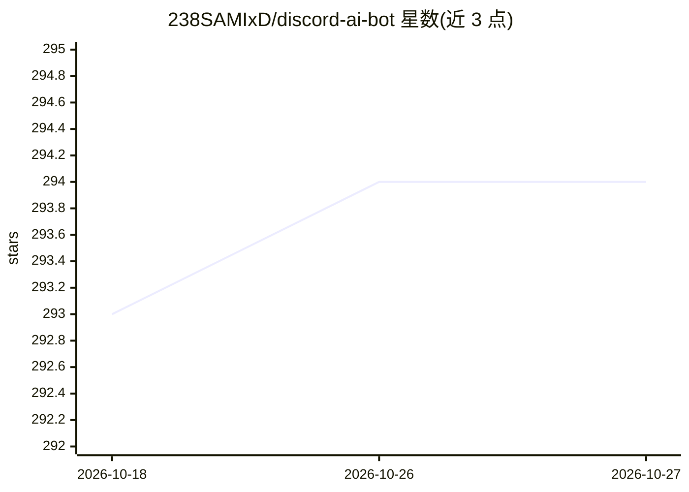

# 238SAMIxD/discord-ai-bot

⭐ 294 · JavaScript · 推送 2026-06-17 · [GitHub](https://github.com/238SAMIxD/discord-ai-bot) · [官网](https://github.com/ollama/ollama) · 个人维护

**接入 Ollama 与 Stable Diffusion 的 Discord AI 聊天机器人**

用 Node.js/TypeScript 编写的 Discord 机器人：在指定频道中被 @提及时调用本地 Ollama 服务生成对话回复，并可对接 AUTOMATIC1111 Stable Diffusion WebUI 的 API 生成图像。支持配置多个 Ollama 服务器地址、按频道 ID 限定生效频道、自定义或关闭系统提示。安装需先部署 Ollama 并拉取模型（如 orca/llama2），再通过 npm 安装依赖启动，或使用 Docker Compose 运行；Stable Diffusion 为可选步骤。仓库声明处于维护模式，正在 typescript 分支重写。

## 筛选速览

| 维度 | 判定 | 备注 |
|---|---|---|
| AI 角色 | `ai-native` | 本体是模型或模型工具 |
| 许可风险 | `none` | — |
| 部署形态 | `self-host` | docker 或自建部署 |
| 模型依赖 | local-ok | 支持本地模型 |
| 硬件要求 | — | 无带数字的原话,不猜 |
| 安装摩擦 | `low` | 无编译、无系统依赖或容器化 |
| 成熟度 | — | 结构信号不足 |

## 能力要点

- 通过 @提及在 Discord 频道中与 Ollama 模型对话
- 可对接 AUTOMATIC1111 Stable Diffusion API（--api --listen）
- 支持多个 Ollama 服务器地址与按频道 ID 配置
- 提供 npm 与 Docker Compose 两种运行方式

## 适用场景

- 在 Discord 服务器里用本地模型提供 AI 聊天
- 让频道成员通过提及机器人生成对话或图像
- 多 Ollama 服务器负载分摊的社区机器人部署

## 场景标签

`聊天机器人` `图像生成` · 领域:对话与助手

## 证据(README 行号)

> L3:  Discord bot to interact with Ollama and AUTOMATIC1111 Stable Diffusion as a chatbot
> L33: 10. You can interact with the bot by @mentioning it with your message

## 星数曲线

2026-10-18 293 → 2026-10-27 294（+1）

---
*卡片 v1 · prompt 1.4 · 生成 2026-10-22 · 置信度 high · 依据 README sha `9190ac3a4359` · [字段定义](../../DATASET.md)*
