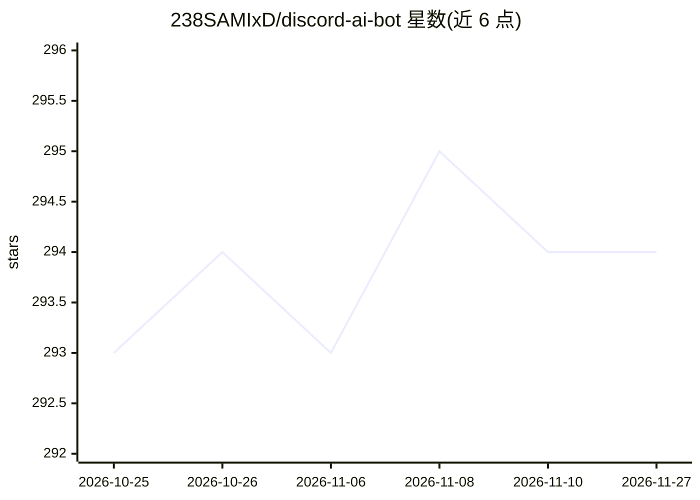

# 238SAMIxD/discord-ai-bot

⭐ 294 · TypeScript · 推送 2026-11-16 · [GitHub](https://github.com/238SAMIxD/discord-ai-bot) · [官网](https://github.com/ollama/ollama) · 个人维护

**接入 Ollama 与 Stable Diffusion 的 Discord 聊天/画图机器人**

以斜杠命令交互的 Discord 机器人：/chat 与 /generate 调用 Ollama 生成文本，/text2img 调用 AUTOMATIC1111 Stable Diffusion 生成图像，/models 列出可用模型，/clearhistory 清除历史。对话按用户与频道分别保存在 SQLite 中，每用户每频道保留最近 50 条。支持视觉模型读取图片附件、多个 Ollama 服务器负载排队、回复中断（Stop 按钮）、生成统计按钮与慢速模式，通过 Node.js 22+ 与 pnpm 运行，也可用 Docker Compose 部署。

## 筛选速览

| 维度 | 判定 | 备注 |
|---|---|---|
| AI 角色 | `ai-native` | 本体是模型或模型工具 |
| 许可风险 | `none` | — |
| 部署形态 | `self-host` | docker 或自建部署 |
| 模型依赖 | local-ok | 支持本地模型 |
| 硬件要求 | — | 无带数字的原话,不猜 |
| 安装摩擦 | `low` | 无编译、无系统依赖或容器化 |
| 成熟度 | — | 结构信号不足 |

## 能力要点

- /chat、/generate 走 Ollama，/text2img 走 AUTOMATIC1111 Stable Diffusion API
- 对话历史存 SQLite，按用户×频道隔离，重启后保留
- 支持视觉模型读取图片附件（llava、qwen2.5vl 等）
- 多服务器排队与每用户慢速模式，Stop 按钮可中断请求

## 适用场景

- 在 Discord 服务器里通过斜杠命令与本地 LLM 对话
- 在聊天中用文字生成图像
- 多用户共享有限的本地推理服务器并排队使用

## 场景标签

`聊天机器人` `图像生成` · 领域:对话与助手

## 证据(README 行号)

> L2:  Discord bot to interact with Ollama and AUTOMATIC1111 Stable Diffusion as a chatbot
> L31:  - While `/chat`, `/generate` or `/text2img` runs, its reply shows a red Stop button that only the person who ran t
> L39: 10. You can interact with the bot with its slash commands: `/chat`, `/generate`, `/text2img`, `/models` and `/clear

## 星数曲线

2026-10-25 293 → 2026-11-27 294（+1）

---
*卡片 v1 · prompt 1.4 · 生成 2026-11-25 · 置信度 high · 依据 README sha `86f18fb82ca6` · [字段定义](../../DATASET.md)*
