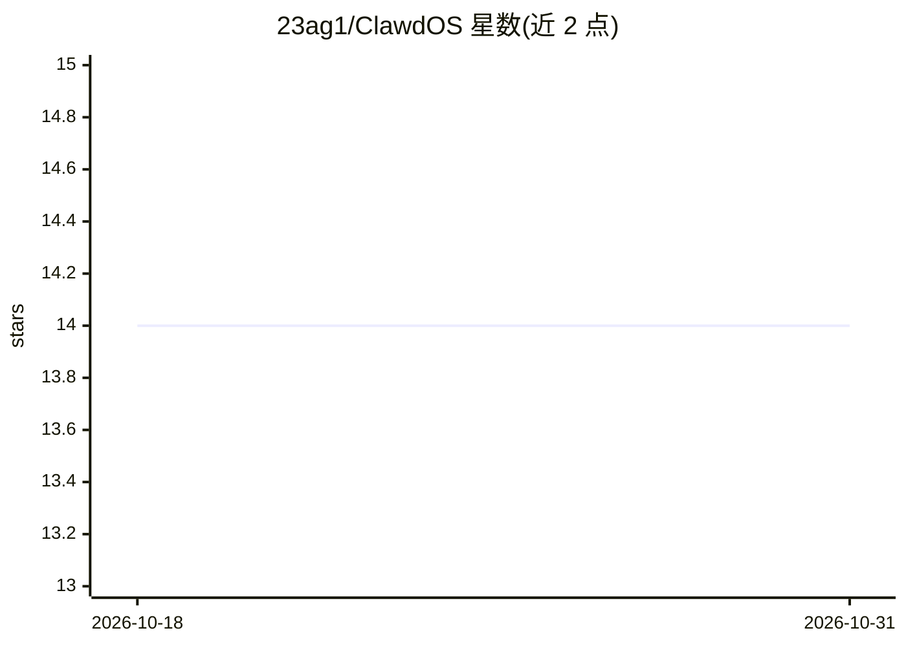

# 23ag1/ClawdOS

⭐ 14 · TypeScript · MIT · 推送 2026-03-02 · [GitHub](https://github.com/23ag1/ClawdOS) · 个人维护

**OpenClaw 个人 AI agent 的自托管 Web 工作台与仪表盘**

基于 Next.js 16 的 Web GUI，为 OpenClaw 个人 AI agent 提供可视化生产力工作区：AI 聊天面板、任务管理（看板/日历/时间线）、富文本笔记、RSS 新闻聚合、1500+ 承运商的包裹追踪、实时仪表盘与技能市场。通过 OpenAI 兼容的本地 HTTP 网关连接 OpenClaw，采用正则/离线嵌入/LLM 三层意图路由。面向自托管用户，依赖 Node.js>=22、Docker 与运行中的 OpenClaw，官方建议仅部署于私有网络。

## 筛选速览

| 维度 | 判定 | 备注 |
|---|---|---|
| AI 角色 | `ai-ecosystem` | LLM/agent 周边工具 |
| 许可风险 | `permissive` | MIT |
| 部署形态 | `library` | 以包/库形式分发 |
| 模型依赖 | — | README 未给出锁定关系 |
| 硬件要求 | — | 无带数字的原话,不猜 |
| 安装摩擦 | `low` | 无编译、无系统依赖或容器化 |
| 成熟度 | — | 结构信号不足 |

## 能力要点

- AI 通过自然语言在工作区内执行任务、笔记、RSS、包裹追踪与技能安装等操作
- 三层本地优先意图路由（正则 <1ms、离线嵌入 ~6ms、LLM 兜底）
- 技能市场浏览与安装 OpenClaw 技能（经 ClawdHub 管理）
- 安全机制：Argon2id、iron-session、PostgreSQL 行级安全、可选 Telegram 2FA

## 适用场景

- 给终端里运行的 OpenClaw agent 配一个可视化操作界面
- 用自然语言管理任务、笔记、新闻源和包裹追踪
- 在私有网络上自托管一个带 AI 助手的个人仪表盘

## 场景标签

`AI 助手` `知识库管理` · 领域:对话与助手

## 证据(README 行号)

> L10:  A full-featured web GUI, dashboard, and productivity workspace for your OpenClaw AI agent.
> L97: ClawdOS connects to your **OpenClaw** agent over a local HTTP gateway (OpenAI-compatible API). ClawdOS handles UI, 
> L100: Browser  ──▶  ClawdOS (Next.js)  ──▶  OpenClaw agent

## 星数曲线

2026-10-18 14 → 2026-10-31 14（+0）

---
*卡片 v1 · prompt 1.4 · 生成 2026-10-31 · 置信度 high · 依据 README sha `d40ad8860468` · [字段定义](../../DATASET.md)*
