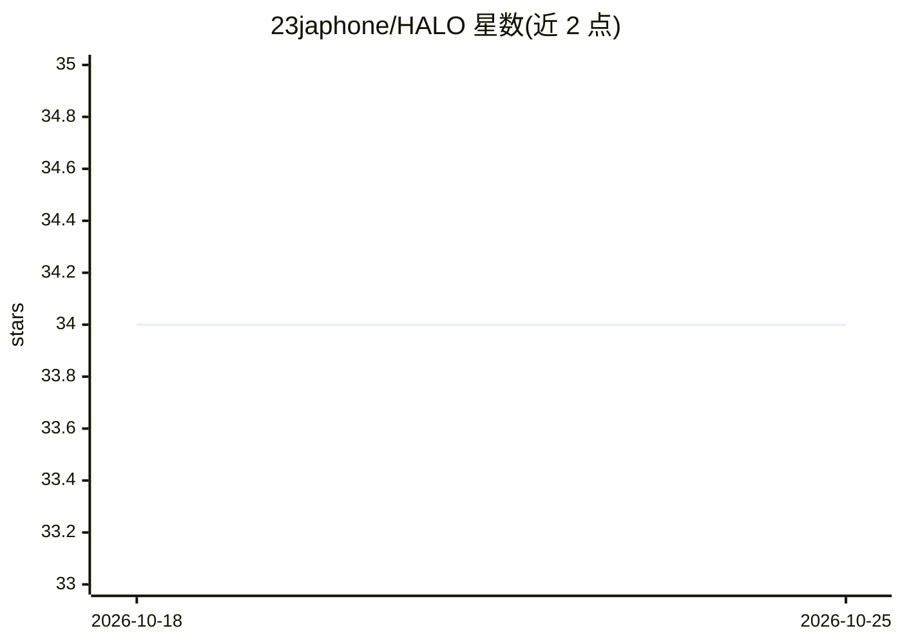

# 23japhone/HALO

⭐ 34 · Python · NOASSERTION · 推送 2026-07-28 · [GitHub](https://github.com/23japhone/HALO) · [官网](https://arxiv.org/abs/2505.13516) · 个人维护

**多智能体 LLM 协作框架：分层推理架构 + MCTS 工作流搜索**

HALO 是论文《Hierarchical Autonomous Logic-Oriented Orchestration for Multi-Agent LLM Systems》的官方实现，提供基于分层推理架构的多智能体协作框架：高层规划智能体做任务分解，中层角色设计智能体按子任务实例化智能体，低层推理智能体执行子任务；子任务执行被表述为结构化工作流搜索问题，用蒙特卡洛树搜索（MCTS）探索智能体动作空间构建推理轨迹，并含自适应提示精炼模块。安装通过 conda 环境加 pip 安装 requirements.txt，运行需自建 api_setting.json 配置 OpenAI 兼容接口（推荐 GPT-4o），在 run.py 中修改查询后运行。附 HumanEval/MMLU/MATH 三基准与消融实验脚本。

## 筛选速览

| 维度 | 判定 | 备注 |
|---|---|---|
| AI 角色 | `ai-ecosystem` | LLM/agent 周边工具 |
| 许可风险 | `none` | NOASSERTION |
| 部署形态 | `library` | 以包/库形式分发 |
| 模型依赖 | — | README 未给出锁定关系 |
| 硬件要求 | — | 无带数字的原话,不猜 |
| 安装摩擦 | `low` | 无编译、无系统依赖或容器化 |
| 成熟度 | — | 结构信号不足 |

## 能力要点

- 高层规划/中层角色设计/低层执行的三层智能体架构
- 以 MCTS 探索智能体动作空间构建工作流
- 自适应提示精炼模块将原始查询转为任务专用提示
- 内置 HumanEval/MMLU/MATH 基准实验与消融脚本

## 适用场景

- 在代码生成、通用推理与数学推理任务上运行多智能体系统
- 复现论文实验与消融研究
- 基于 OpenAI 兼容 API 接入自定义模型进行任务分解与执行

## 场景标签

`多智能体` `Agent 框架` · 领域:Agent 开发

## 证据(README 行号)

> L28:  Abstract

## 星数曲线

2026-10-18 34 → 2026-10-25 34（+0）

---
*卡片 v1 · prompt 1.4 · 生成 2026-10-25 · 置信度 mid · 依据 README sha `6d523eda12bf` · [字段定义](../../DATASET.md)*
