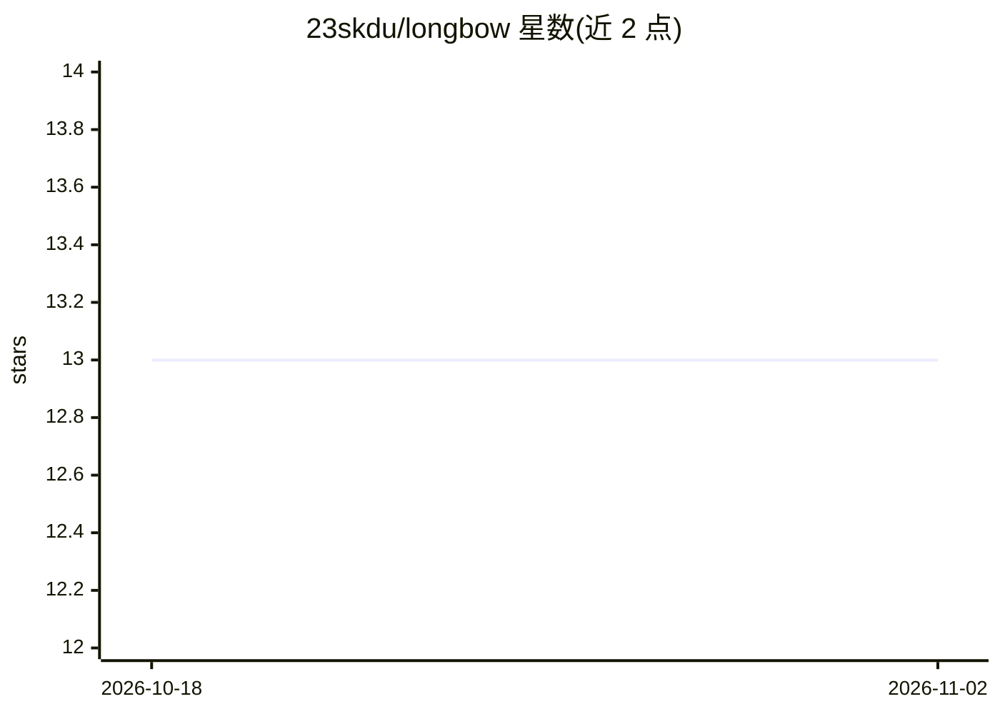

# 23skdu/longbow

⭐ 13 · Go · NOASSERTION · 推送 2026-10-30 · [GitHub](https://github.com/23skdu/longbow) · [官网](https://github.com/23skdu/longbow) · 个人维护

**分布式向量引擎：为 Agent 记忆共享提供低延迟向量检索**

基于 Apache Arrow Flight 协议的分布式向量引擎，面向 AI/Agentic 工作负载。采用 shared-nothing 架构，节点间以一致性哈希与 SWIM 协议（gossip）组织；提供 HNSW 向量搜索（稠密+稀疏混合）、SIMD 加速的多种数值类型内核与谓词过滤、可选 io_uring WAL 与 Parquet 快照、NUMA 感知内存分配、tombstone 删除、双 gRPC 端口分离数据与元数据流量、100+ Prometheus 指标。以 Go 编写，需 Go 1.25+ 从源码构建，Linux/macOS 运行；GPU（Metal/CUDA）支持需编译对应平台二进制，否则回退 CPU。

## 筛选速览

| 维度 | 判定 | 备注 |
|---|---|---|
| AI 角色 | `ai-ecosystem` | LLM/agent 周边工具 |
| 许可风险 | `none` | NOASSERTION |
| 部署形态 | `self-host` | docker 或自建部署 |
| 模型依赖 | — | README 未给出锁定关系 |
| 硬件要求 | — | 无带数字的原话,不猜 |
| 安装摩擦 | `low` | 无编译、无系统依赖或容器化 |
| 成熟度 | — | 结构信号不足 |

## 能力要点

- Apache Arrow Flight 协议上的 HNSW 混合（Dense+Sparse）向量搜索
- SIMD 优化内核覆盖 float32/16/64、整型、complex、turboquant 等类型（128-3072 维）
- 一致性哈希 + SWIM gossip 成员管理的分布式 shared-nothing 架构
- WAL + Parquet 快照持久化与 100+ Prometheus 指标

## 适用场景

- 为 Agent 集群提供共享的高吞吐向量记忆存储
- 作为自托管向量检索服务处理 k-NN 搜索与过滤查询
- 通过 Go SDK 透明路由请求访问分布式向量集群

## 场景标签

`向量数据库` `Agent 记忆` · 领域:Agent 开发

## 证据(README 行号)

> L9: Longbow is a distributed, high-performance vector engine built for modern AI/Agentic workloads. It leverages zero-co
> L91: - **Protocol**: Apache Arrow Flight (over gRPC/HTTP2).

## 星数曲线

2026-10-18 13 → 2026-11-02 13（+0）

---
*卡片 v1 · prompt 1.4 · 生成 2026-10-31 · 置信度 high · 依据 README sha `71b4eef64c44` · [字段定义](../../DATASET.md)*
