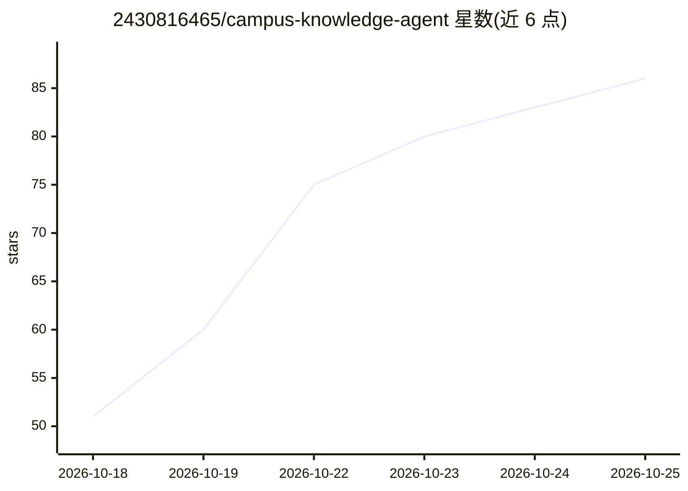

# 2430816465/campus-knowledge-agent

⭐ 86 · Python · 推送 2026-10-14 · [GitHub](https://github.com/2430816465/campus-knowledge-agent) · [官网](https://zlyb.cloud) · 个人维护 · 中文 README

**校园通知与办事资料的 RAG 问答平台，含证据溯源与人工审核**

基于 Python/FastAPI/SQLAlchemy/Ollama/Qwen3 的校园知识服务应用：归档公开官网页面与附件，解析 PDF/Word/表格并做本地 OCR，检索时按事项、年度、可见范围过滤，回答附带原文证据窗口与出处定位；通过字段核对、待核实状态、审核发布与撤回实现人工审核。默认 SQLite，开发环境用过 PostgreSQL；全库语义索引为默认关闭的试验能力。本地运行需 Ollama 与相应模型资源，公网演示依赖本机服务在线。

## 筛选速览

| 维度 | 判定 | 备注 |
|---|---|---|
| AI 角色 | `ai-native` | 本体是模型或模型工具 |
| 许可风险 | `none` | — |
| 部署形态 | `library` | 以包/库形式分发 |
| 模型依赖 | local-ok | 支持本地模型 |
| 硬件要求 | — | 无带数字的原话,不猜 |
| 安装摩擦 | `low` | 无编译、无系统依赖或容器化 |
| 成熟度 | — | 结构信号不足 |

## 能力要点

- 公开站点归档与 PDF/Word/表格解析、本地 OCR
- Evidence Grounding / Provenance / Temporal Scoping 证据治理机制
- Human-in-the-loop 审核发布与撤回流程
- 有界多轮语境，历史不作为政策证据

## 适用场景

- 查询校园通知、竞赛、学籍与办事资料并获得可溯源回答
- 避免相似政策跨年度混用，限定年度与适用范围检索
- 教师对候选字段做核对后再发布为正式内容

## 场景标签

`文档问答` `文档解析` · 领域:知识与检索

## 证据(README 行号)

> L3: 基于 **Python / FastAPI / SQLAlchemy / Ollama / Qwen3** 搭建的校园知识服务应用，围绕公开通知、竞赛、学籍及办事资料，实现从资料采集、附件解析到检索问答、证据溯源与人工审核的完整业务
> L5: 项目采用 **RAG（Retrieval-Augmented Generation，检索增强生成）** 和证据约束工作流：先限定事项、年度及可见范围，再检索原文、组织回答并返回来源。这里的 Agent 指知识服务工作流；当前实现以检

## 星数曲线

2026-10-18 51 → 2026-10-25 86（+35）

---
*卡片 v1 · prompt 1.4 · 生成 2026-10-24 · 置信度 high · 依据 README sha `d69c415b875f` · [字段定义](../../DATASET.md)*
