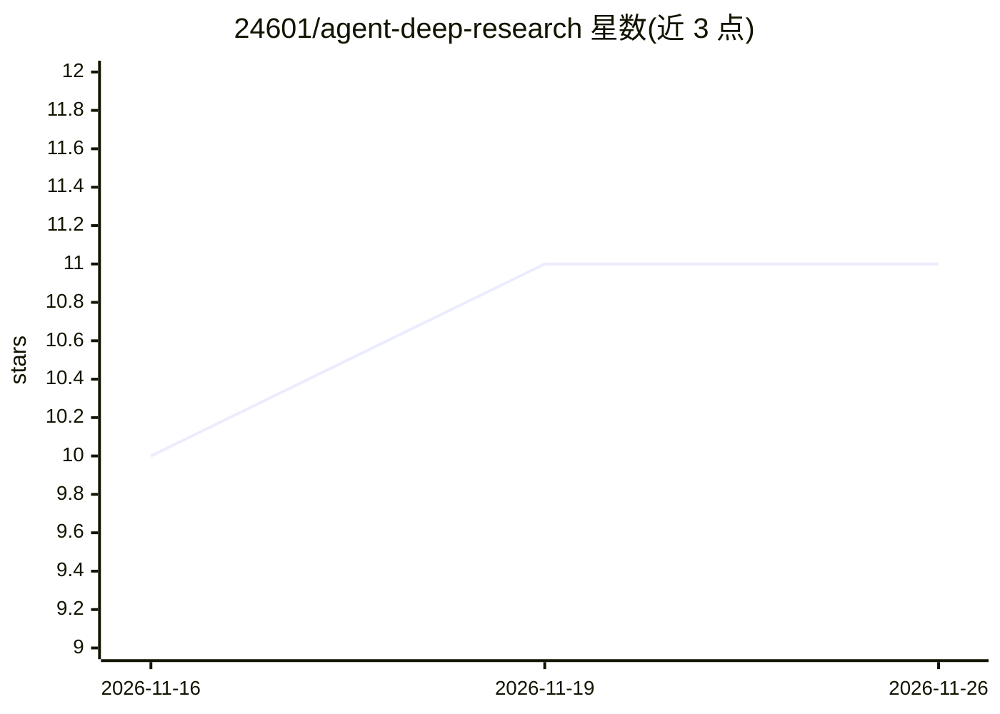

# 24601/agent-deep-research

⭐ 11 · Python · MIT · 推送 2026-06-22 · [GitHub](https://github.com/24601/agent-deep-research) · 个人维护

**AI agent 的深度研究技能：调 Gemini API 产出带引用报告**

一组 Python CLI 脚本形式的通用 agent skill，通过 Google Gemini Interactions API 直接调用（不依赖 Gemini CLI），提供后台深度研究任务（start/status/report）、本地文件 RAG grounding（--context 自动建临时文件搜索 store）、成本预估（--dry-run/--max-cost）、历史自适应轮询、结构化输出目录（report.md/metadata.json/sources.json）与 Markdown/HTML/PDF 导出。安装走 npx skills add 或 ClawHub registry，需 Google API key 与 uv。已知问题：store grounding 可能被上游实验性 API 拒绝并回退 web-only。

## 筛选速览

| 维度 | 判定 | 备注 |
|---|---|---|
| AI 角色 | `ai-native` | 本体是模型或模型工具 |
| 许可风险 | `permissive` | MIT |
| 部署形态 | `library` | 以包/库形式分发 |
| 模型依赖 | — | README 未给出锁定关系 |
| 硬件要求 | — | 无带数字的原话,不猜 |
| 安装摩擦 | `low` | 无编译、无系统依赖或容器化 |
| 成熟度 | — | 结构信号不足 |

## 能力要点

- 通过 npx skills add 安装，兼容 Claude Code、Amp、Codex、Cursor 等 30+ agent
- 本地文件自动建临时文件搜索 store 做 RAG grounding（--context）
- --dry-run 成本预估、--max-cost 超限中止、历史自适应轮询
- stderr 人类可读输出 / stdout 机器可读 JSON 的双输出约定

## 适用场景

- 让编码 agent 具备深度网络研究并产出报告的能力
- 以自有文档/代码库为上下文做 RAG-grounded 研究
- 学术式文献综述或竞品情报分析
- CI/无 TTY 环境中非交互调用研究脚本

## 场景标签

`RAG` `科研工具` · 领域:知识与检索

## 证据(README 行号)

> L7: Deep research and RAG-grounded file search powered by the Google Gemini Interactions API. A universal AI agent skill
> L81: This tool turns any AI agent into a domain specialist. The async, multi-step synthesis produces expert-grade output
> L149: uv run scripts/research.py start "your question"       # Start research

## 星数曲线

2026-11-16 10 → 2026-11-26 11（+1）

---
*卡片 v1 · prompt 1.4 · 生成 2026-11-19 · 置信度 mid · 依据 README sha `1ac3f8ee4c00` · [字段定义](../../DATASET.md)*
