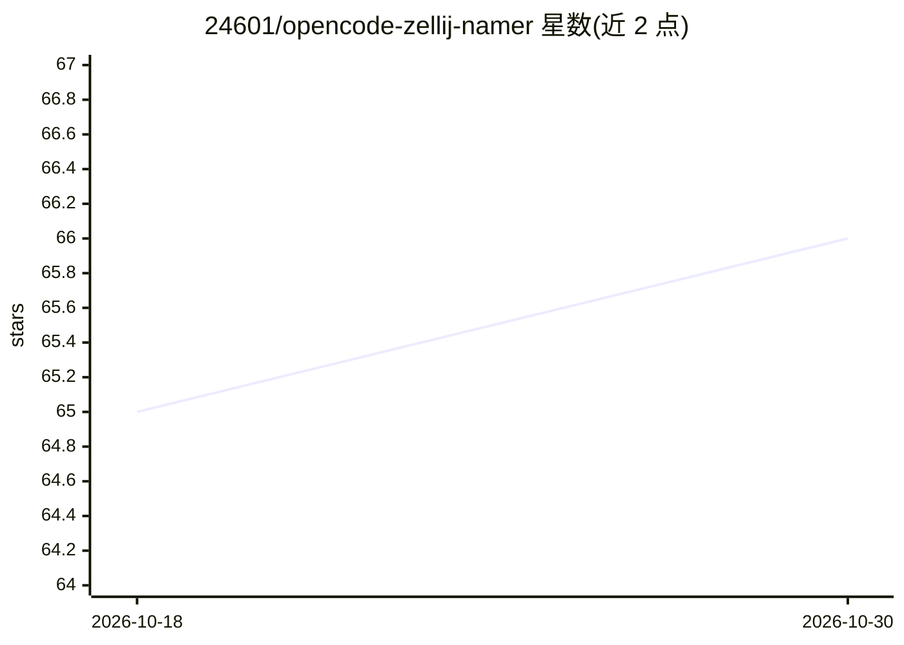

# 24601/opencode-zellij-namer

⭐ 66 · TypeScript · MIT · 推送 2025-12-20 · [GitHub](https://github.com/24601/opencode-zellij-namer) · 个人维护

**给终端用户/开发者：按工作内容自动命名 Zellij 会话的 OpenCode 插件**

OpenCode 插件，监听 session.idle、file.edited、command.executed、todo.updated 等事件，读取项目名、文件路径、命令与待办摘要，调用 Gemini 3 Flash 生成 project-intent-tag 格式的会话名（如 myapp-debug-auth）。支持从 AGENTS.md 提取项目级命名规范，环境变量自定义指令可覆盖。未设置 GEMINI_API_KEY 时退化为模式匹配启发式命名。内置防抖（5 秒）与冷却（5 分钟）机制，仅发送最小上下文到 API。需 OpenCode v0.1.0+、Zellij、Node.js 18+。

## 筛选速览

| 维度 | 判定 | 备注 |
|---|---|---|
| AI 角色 | `ai-enhanced` | 去掉 AI 部分产品仍成立 |
| 许可风险 | `permissive` | MIT |
| 部署形态 | `library` | 以包/库形式分发 |
| 模型依赖 | — | README 未给出锁定关系 |
| 硬件要求 | — | 无带数字的原话,不猜 |
| 安装摩擦 | `low` | 无编译、无系统依赖或容器化 |
| 成熟度 | — | 结构信号不足 |

## 能力要点

- 基于 Gemini 3 Flash 生成 project-intent-tag 格式会话名
- 读取 AGENTS.md 项目命名规范，自定义指令可覆盖
- 无 API key 时退化为启发式命名
- 防抖与冷却机制防止名称频繁变动，多会话去重命名

## 适用场景

- 多终端同项目开发时快速区分各 Zellij 会话
- 团队通过 AGENTS.md 统一会话命名规范
- 不想配置 AI key 也能用规则命名会话

## 场景标签

 · 领域:开发者工具/终端

## 证据(README 行号)

> L14: - **AI-powered**: Uses Gemini 3 Flash to generate contextual, meaningful names
> L19: - **Privacy-conscious**: Only sends minimal context to AI (see Privacy)
> L189: **To disable AI**: Simply don't set `GEMINI_API_KEY`. The plugin falls back to heuristic naming.

## 星数曲线

2026-10-18 65 → 2026-10-30 66（+1）

---
*卡片 v1 · prompt 1.4 · 生成 2026-10-24 · 置信度 high · 依据 README sha `050acb5d2472` · [字段定义](../../DATASET.md)*
