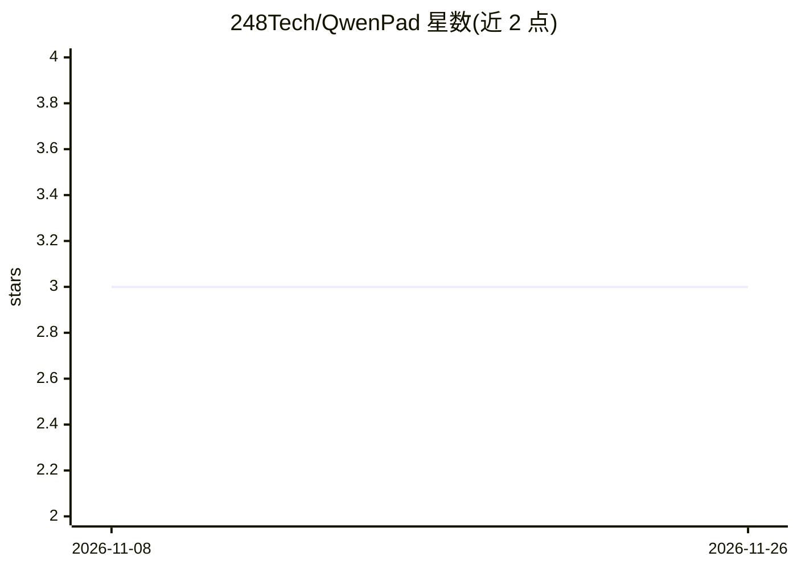

# 248Tech/QwenPad

⭐ 3 · C# · MIT · 推送 2026-11-17 · [GitHub](https://github.com/248Tech/QwenPad) · [官网](https://248tech.github.io/QwenPad/) · 个人维护

**带本地 Qwen3.5 AI 的 Windows 桌面便签与小记事本**

面向 Windows 的原生便签与记事本应用，C# 编写，约 230 KB、无安装器、可解压到任意位置（含 U 盘）运行。便签支持 23 种手绘主题、富文本、图片/GIF、手绘、置顶与透明度；记事本覆盖查找替换、编码与换行符识别等常规功能。AI 部分通过 llama.cpp 在本地运行 Qwen3.5 文本模型与 stable-diffusion.cpp 运行 Qwen-Image-2.1 图像模型，提供改写、摘要、自动标题、文生图与图片编辑；便签功能在无模型时也可使用。首次启动需从 Hugging Face 下载模型（2.6–5.3 GB，图像模型约 11 GB），之后完全离线。

## 筛选速览

| 维度 | 判定 | 备注 |
|---|---|---|
| AI 角色 | `ai-enhanced` | 去掉 AI 部分产品仍成立 |
| 许可风险 | `permissive` | MIT |
| 部署形态 | `desktop` | 安装包/桌面程序 |
| 模型依赖 | local-ok | 支持本地模型 |
| 硬件要求 | — | 无带数字的原话,不猜 |
| 安装摩擦 | `medium` | 含编译或系统依赖之一 |
| 成熟度 | — | 结构信号不足 |

## 能力要点

- Ctrl+K 调用本地 Qwen 改写选区、续写、生成清单与摘要
- Image Studio 通过 stable-diffusion.cpp 本地文生图与图片编辑
- 23 种手绘主题、置顶、透明度、开机自启等便签特性
- 原生 ~230 KB 便携应用，无 Electron、无安装器，MIT 许可

## 适用场景

- 在桌面放置置顶便签记录待办并用 AI 整理成清单
- 断网/飞行模式下离线改写、摘要和翻译文本
- 本地生成与编辑图片并直接放入便签
- 把 RTSP 摄像头画面作为常驻便签显示

## 场景标签

`AI 写作` `图像生成` · 领域:内容生成

## 证据(README 行号)

> L5: **Beautiful desktop sticky notes and a tiny Notepad for Windows, with a private AI that runs on your own PC.**
> L20: Windows Sticky Notes is plain. Notepad is dumb. Cloud AI editors read everything you type. **QwenPad gives you gorg
> L116: Already have a `.gguf` model? Drop it into the `models\` folder and pick it from **Qwen > Model**. The sticky note

## 星数曲线

2026-11-08 3 → 2026-11-26 3（+0）

---
*卡片 v1 · prompt 1.4 · 生成 2026-11-22 · 置信度 high · 依据 README sha `60b0be5c8df2` · [字段定义](../../DATASET.md)*
