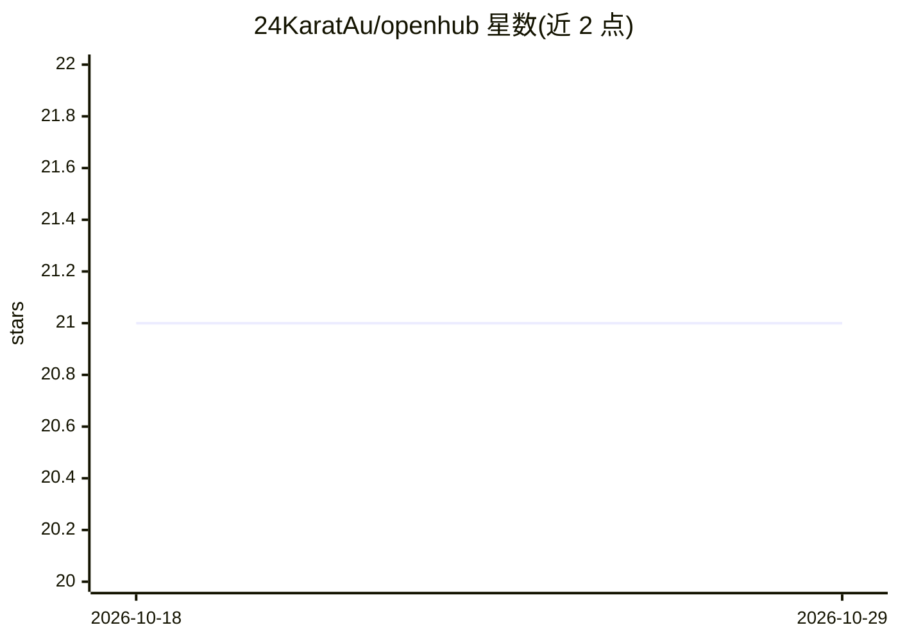

# 24KaratAu/openhub

⭐ 21 · Python · MIT · 推送 2026-09-27 · [GitHub](https://github.com/24KaratAu/openhub) · [官网](https://github.com/24KaratAu/openhub) · 个人维护

**终端 TUI 的 AI 编码工具发现与安装中心**

基于 Python、Textual 与 SQLite 构建的终端用户界面应用，面向 AI 编码工具、技能与 agent 的发现、安装和管理：提供仪表盘目录、容错模糊搜索、精选合集、一键导出 SKILL.md 到 OpenCode、Claude Code、Cursor 等各类 agent IDE 的技能目录，并支持已装技能的版本更新（失败自动回滚备份）与操作历史记录。开箱零配置，匿名 GitHub 请求限额 60 次/小时，设置 token 可提升至 5000 次/小时。

## 筛选速览

| 维度 | 判定 | 备注 |
|---|---|---|
| AI 角色 | `ai-ecosystem` | LLM/agent 周边工具 |
| 许可风险 | `permissive` | MIT |
| 部署形态 | `library` | 以包/库形式分发 |
| 模型依赖 | — | README 未给出锁定关系 |
| 硬件要求 | — | 无带数字的原话,不猜 |
| 安装摩擦 | `low` | 无编译、无系统依赖或容器化 |
| 成熟度 | — | 结构信号不足 |

## 能力要点

- 键盘优先 TUI：仪表盘、Spotlight 式模糊搜索、精选合集
- 按 Universal Open Agent Skills Standard 导出 SKILL.md，兼容 Claude Code / Cursor / Windsurf / Roo Code / OpenCode 等
- 已装技能版本检测与更新，更新失败自动从备份恢复
- 本地 SQLite 缓存即时启动，后台线程同步 GitHub 数据

## 适用场景

- 在终端里浏览和发现 AI 编码工具、MCP 服务器与 agent 技能
- 一键把技能导出到我使用的 AI 编码助手或 IDE
- 追踪已安装技能的版本并批量更新

## 场景标签

 · 领域:开发者工具/AI 生态

## 证据(README 行号)

> L3: A keyboard-first, terminal user interface (TUI) discovery hub and package installer for AI coding tools, skills, and
> L54: 6. **Universal Skill Export**: Press `E` to export 1-click `SKILL.md` prompt instructions directly to `./.agents/sk

## 星数曲线

2026-10-18 21 → 2026-10-29 21（+0）

---
*卡片 v1 · prompt 1.4 · 生成 2026-10-28 · 置信度 high · 依据 README sha `0fe0b7aeaa31` · [字段定义](../../DATASET.md)*
