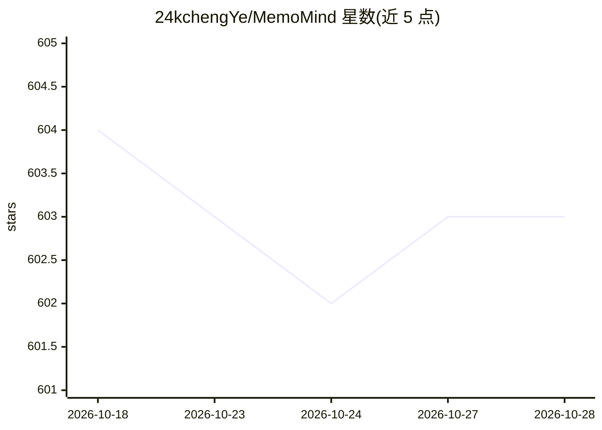

# 24kchengYe/MemoMind

⭐ 603 · Python · 推送 2026-08-07 · [GitHub](https://github.com/24kchengYe/MemoMind) · 个人维护 · 中文 README

**给 AI 编码代理提供持久记忆的本地记忆系统**

面向 Claude Code 等 MCP 编码代理的本地记忆系统：以 PostgreSQL + pgvector + 知识图存储记忆，提供 retain/recall/reflect 三类操作，recall 采用语义+BM25+图+时序的 4 路混合检索；事实提取由 LLM 自动完成。支持多 LLM 提供方（OpenAI/Anthropic/Gemini/Groq/Ollama/LM Studio 及 OpenAI 兼容 API），嵌入用 bge-m3（100+ 语言），本地 NVIDIA GPU 加速，数据不出本机。支持一键导入 ChatGPT/Gemini 对话史与 DayLife 生活事件，带 Web 仪表盘。与 CLAUDE.md 定位互补而非替代。

## 筛选速览

| 维度 | 判定 | 备注 |
|---|---|---|
| AI 角色 | `ai-ecosystem` | LLM/agent 周边工具 |
| 许可风险 | `permissive` | — |
| 部署形态 | `desktop` | 安装包/桌面程序 |
| 模型依赖 | local-ok | 支持本地模型 |
| 硬件要求 | `gpu-24g` | |
| 安装摩擦 | `medium` | 含编译或系统依赖之一 |
| 成熟度 | — | 结构信号不足 |

## 能力要点

- retain/recall/reflect 三操作，4 路混合检索（语义+BM25+知识图+时序）
- 100% 本地：PostgreSQL + pgvector + 知识图，CUDA 加速本地嵌入（bge-m3，100+ 语言）
- 一键导入 ChatGPT/Gemini 对话史并溯源到原始对话，DayLife 生活事件自动同步
- Web 仪表盘（浏览/搜索/过滤）与元数据隔离（按项目/用户）

## 适用场景

- 让编码助手跨会话记住架构决策、编码风格与技术栈偏好
- 复盘调试历史：记录试过什么、什么有效什么无效
- 把 ChatGPT/Gemini 的历史对话合并进统一记忆图供 AI 检索
- 团队新人接手时让 AI 继承项目积累的知识

## 场景标签

`Agent 记忆` · 领域:Agent 开发

## 证据(README 行号)

> L7: *A fully local, GPU-accelerated memory system for AI coding agents. Start building your digital twin's memory today 
> L170: - **Multi-provider LLM** — works with OpenAI, Anthropic, Gemini, Groq, Ollama, LM Studio, and any OpenAI-compatibl
> L164: - **4-way hybrid retrieval** — semantic similarity + BM25 keyword + knowledge graph + temporal search (keyword 20m

## 星数曲线

2026-10-18 604 → 2026-10-28 603（-1）

---
*卡片 v1 · prompt 1.4 · 生成 2026-10-21 · 置信度 high · 依据 README sha `9c74a13ab93d` · [字段定义](../../DATASET.md)*
