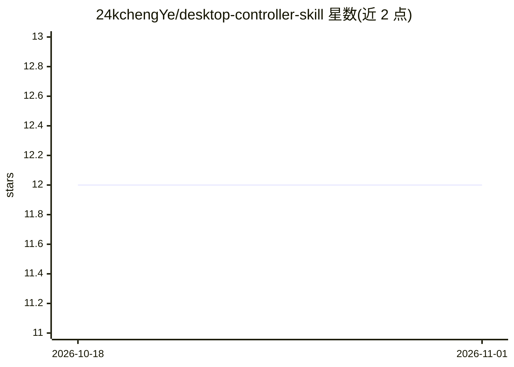

# 24kchengYe/desktop-controller-skill

⭐ 12 · Python · MIT · 推送 2026-03-21 · [GitHub](https://github.com/24kchengYe/desktop-controller-skill) · [官网](https://github.com/24kchengYe/desktop-controller-skill#readme) · 个人维护 · 中文 README

**让 Claude Code 控制 Windows 桌面与网页应用的 AI 技能**

面向 Claude Code 的 agent 技能包，采用双引擎：Win32 API 控制原生 Windows 应用（微信、企业微信、钉钉、飞书、QQ、Telegram、Slack、Teams），Playwright 控制网页与 Electron 应用。提供截图加 Claude 视觉分析的反馈循环、自动化 QA 检查清单与设备视口测试预设，中文通过 Unicode 码点数组处理。以 git clone 到 Claude Code skills 目录方式安装，要求 Windows、Python 3.8+、Node.js 18+ 且目标应用已登录。

## 筛选速览

| 维度 | 判定 | 备注 |
|---|---|---|
| AI 角色 | `ai-ecosystem` | LLM/agent 周边工具 |
| 许可风险 | `permissive` | MIT |
| 部署形态 | `None` |  |
| 模型依赖 | locked-api |  |
| 硬件要求 | — | 无带数字的原话,不猜 |
| 安装摩擦 | `low` | 无编译、无系统依赖或容器化 |
| 成熟度 | — | 结构信号不足 |

## 能力要点

- Win32 + Playwright 双引擎，覆盖原生桌面与网页/Electron 应用
- 截图→Claude 分析→验证的视觉反馈循环
- 一键自动化 QA：功能、视觉、视口与性能检查
- 内置 iPhone/iPad/Pixel 等设备视口预设

## 适用场景

- 让 Claude Code 用自然语言操作微信、钉钉等聊天应用发消息
- 对网页做自动化 QA 与多设备视口测试
- 通过截图与视觉分析验证桌面自动化结果

## 场景标签

`GUI 自动化` `浏览器自动化` · 领域:效率与自动化

## 证据(README 行号)

> L2: # Desktop Controller — AI Computer Use for Claude Code
> L63: ### Natural Language (via Claude Code)

## 星数曲线

2026-10-18 12 → 2026-11-01 12（+0）

---
*卡片 v1 · prompt 1.4 · 生成 2026-11-01 · 置信度 high · 依据 README sha `64179096b83d` · [字段定义](../../DATASET.md)*
