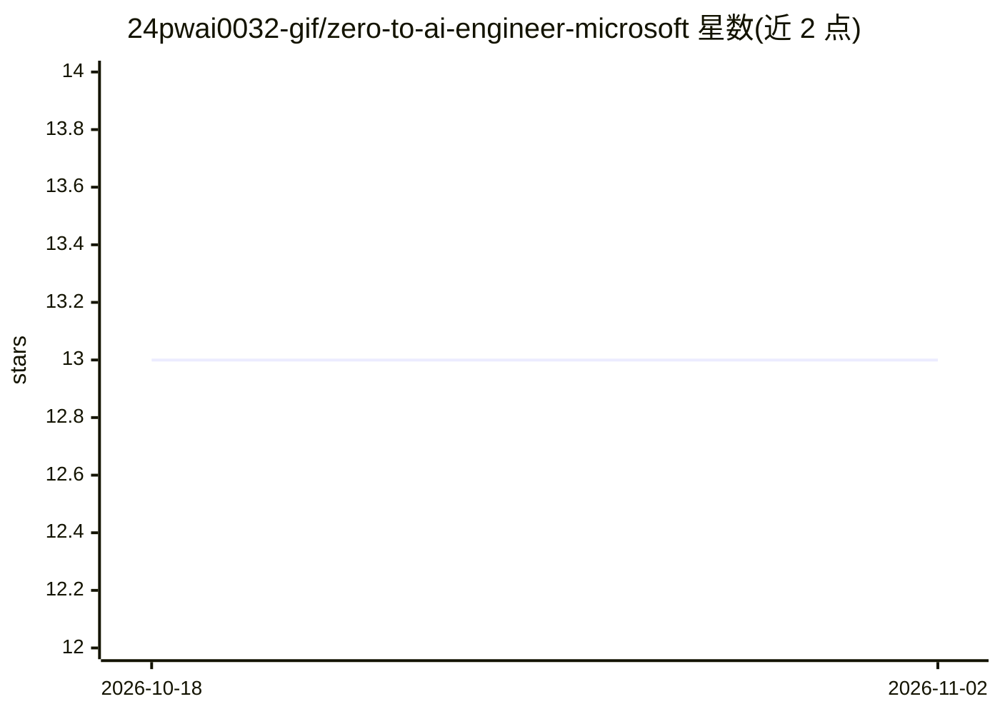

# 24pwai0032-gif/zero-to-ai-engineer-microsoft

⭐ 13 · MIT · 推送 2026-10-06 · [GitHub](https://github.com/24pwai0032-gif/zero-to-ai-engineer-microsoft) · 个人维护

**零基础到 AI 工程师的微软官方内容学习路线图**

由个人维护的免费学习路线图仓库，内容全部取自微软官方 Learn / GitHub / Foundry 文档链接。按 0-5 六个阶段组织：AI 基础（含负责任 AI 与 Azure 概念）、机器学习（Azure ML）、生成式 AI（LLM/提示词/Azure OpenAI）、AI Agent 与 Microsoft Foundry、MLOps 与生产、微软认证考试顺序。每阶段为独立文件夹，含 README 与官方链接清单；从零按序学习或直接跳到对应阶段。仓库本身为链接索引，MIT 许可，原始内容归属微软。

## 筛选速览

| 维度 | 判定 | 备注 |
|---|---|---|
| AI 角色 | `ai-knowledge` | 知识聚合/清单类 |
| 许可风险 | `permissive` | MIT |
| 部署形态 | `None` |  |
| 模型依赖 | — | README 未给出锁定关系 |
| 硬件要求 | — | 无带数字的原话,不猜 |
| 安装摩擦 | `low` | 无编译、无系统依赖或容器化 |
| 成熟度 | — | 结构信号不足 |

## 能力要点

- 六个阶段结构：AI 基础→ML→生成式 AI→Agent→MLOps→认证
- 内容全部来自微软官方免费材料，无付费课程
- 每阶段独立文件夹，含精选官方链接清单

## 适用场景

- 零基础者按顺序自学 AI 并跟进微软生态工具
- 已有基础者直接跳到所需阶段查漏补缺
- 规划微软 AI 认证考试的备考顺序

## 场景标签

`精选清单` · 领域:学习与行业

## 证据(README 行号)

> L7: A free, structured roadmap for anyone starting out in AI, built entirely from official Microsoft Learn material. No 
> L17: Each stage below is a folder with its own `README.md` and a curated list of official links. Work through them top t

## 星数曲线

2026-10-18 13 → 2026-11-02 13（+0）

---
*卡片 v1 · prompt 1.4 · 生成 2026-10-31 · 置信度 high · 依据 README sha `4cccd3310594` · [字段定义](../../DATASET.md)*
